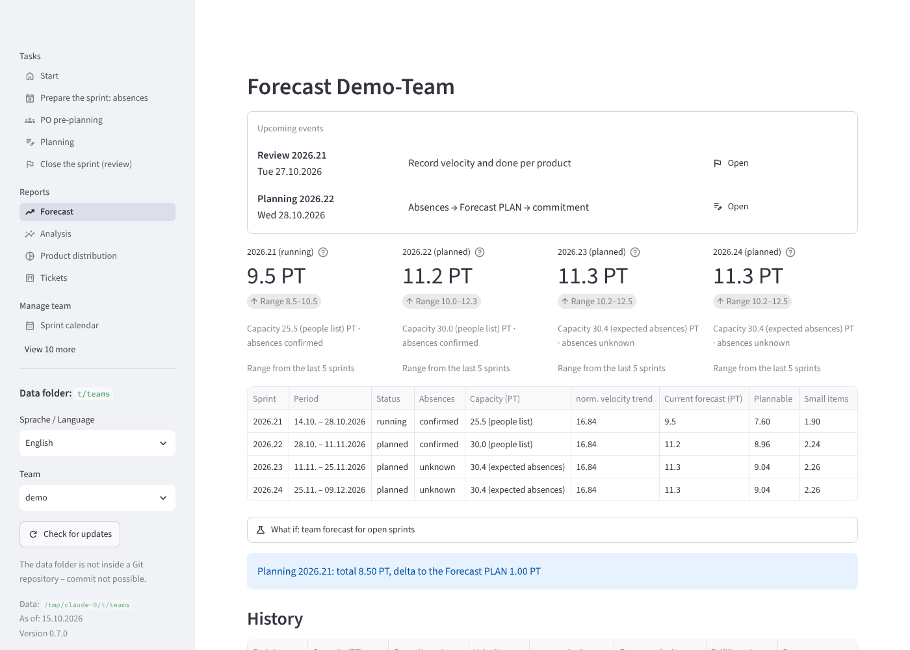
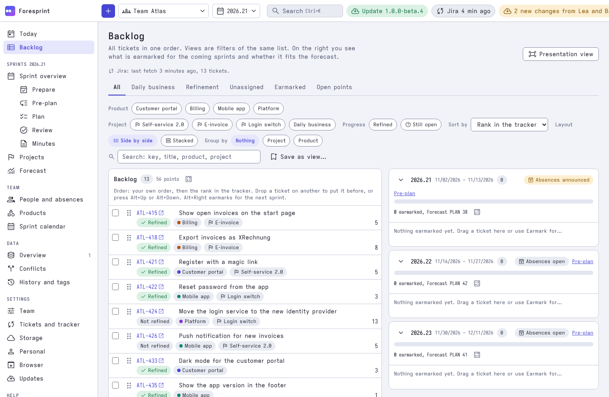
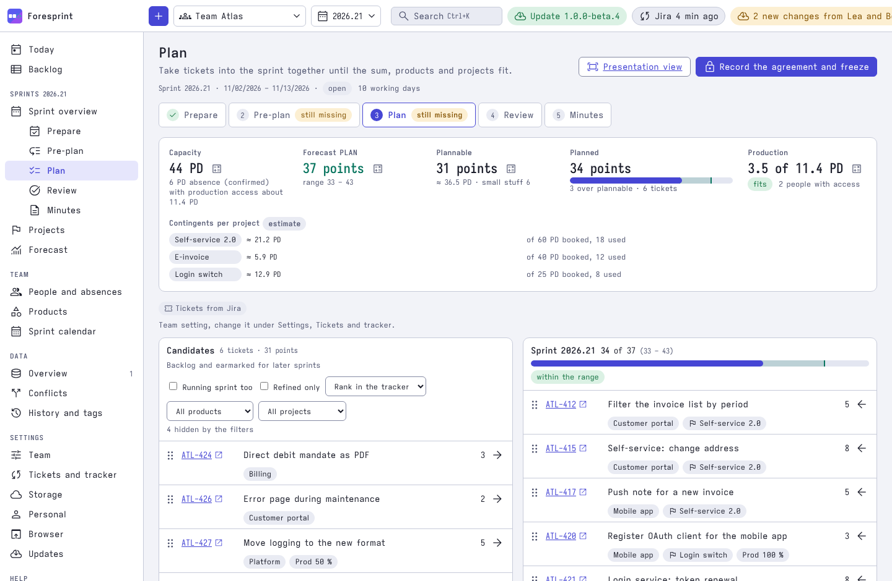
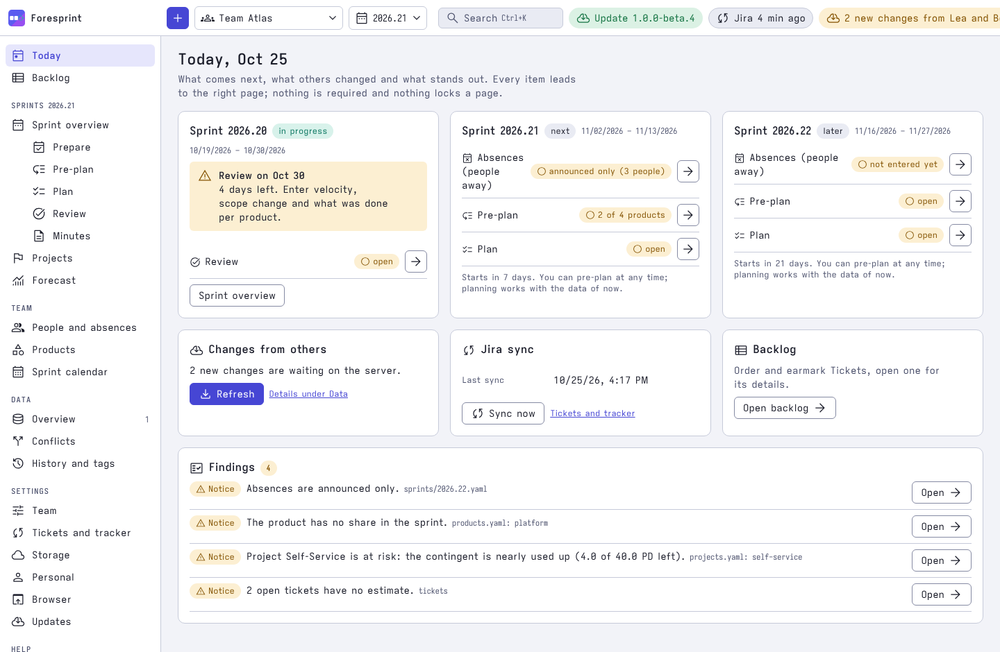
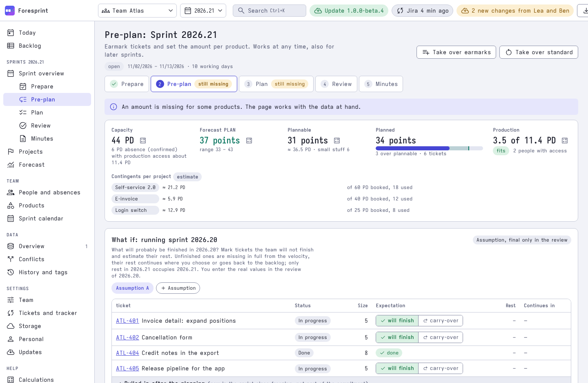
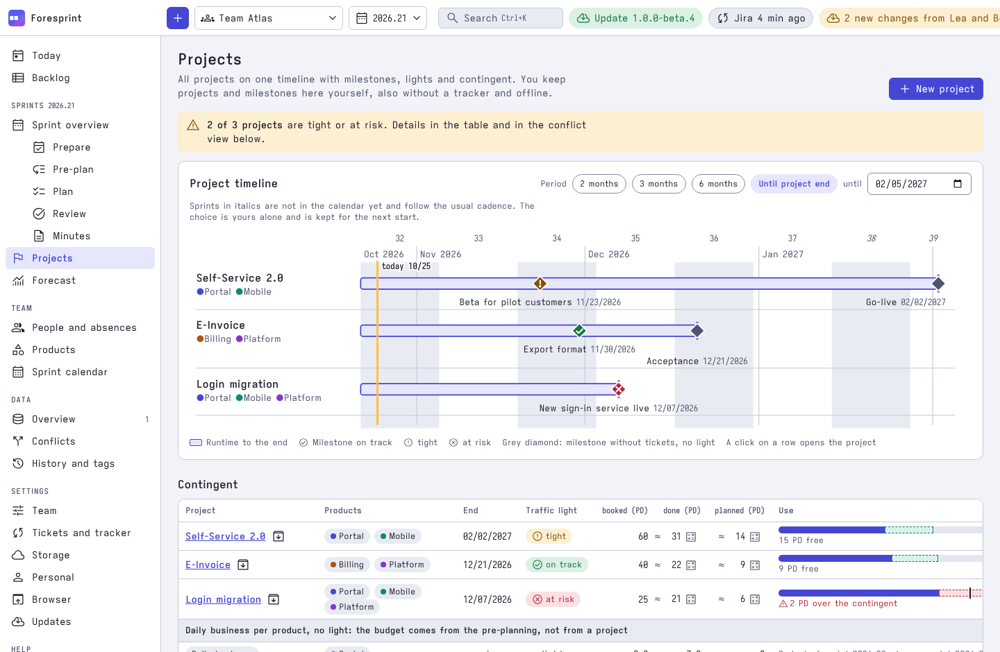
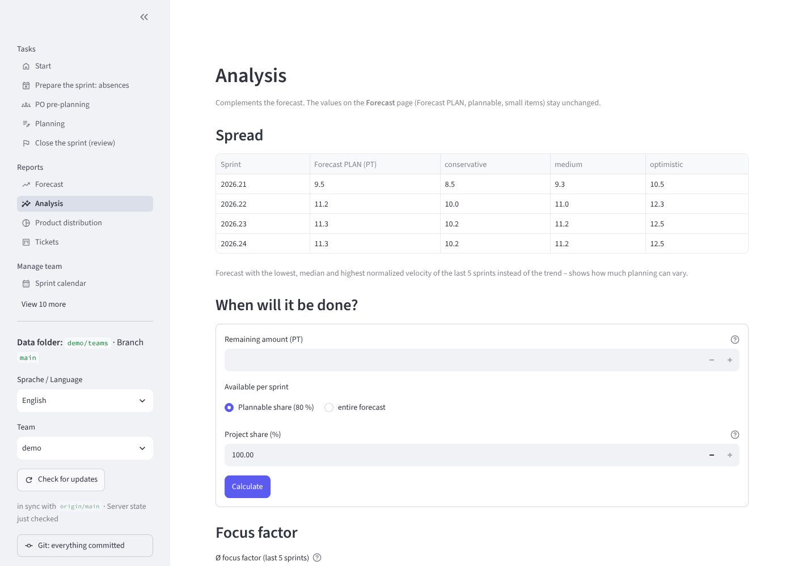
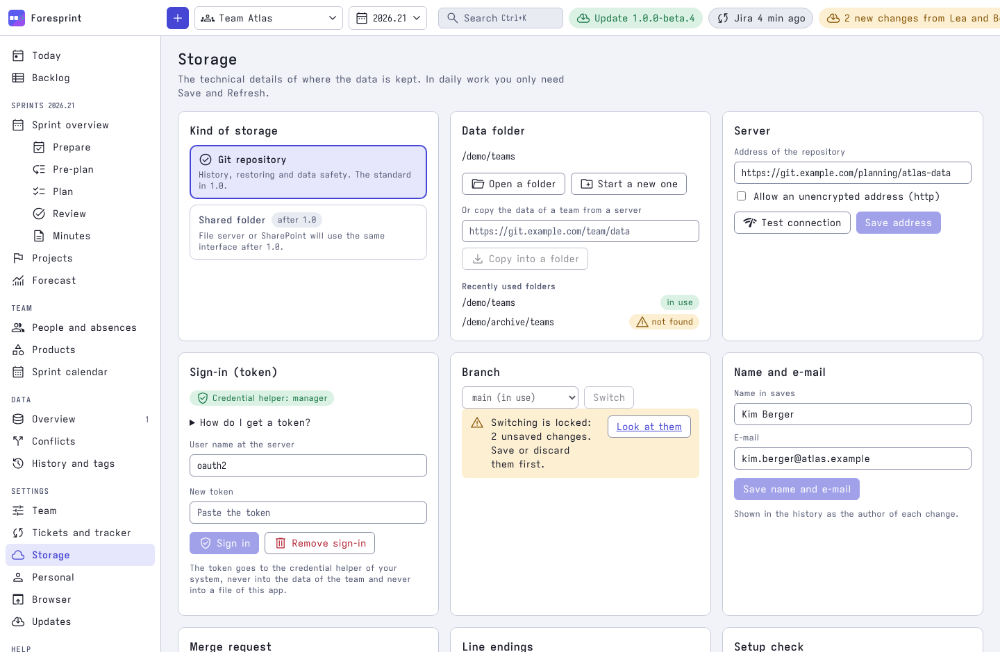

<p align="center">
  <picture>
    <source media="(prefers-color-scheme: dark)" srcset="docs/assets/logo-wordmark-dark.svg">
    
  </picture>
</p>

<h3 align="center">
  How much can the team plan in the next sprint? Forecasts for Scrum teams with several product
  owners and several products, from plain YAML files in your own Git repository.
</h3>

<p align="center">
  <a href="https://github.com/swallat/foresprint/releases/latest"></a>
  <a href="https://github.com/swallat/foresprint/actions/workflows/ci.yml"></a>
  <a href="LICENSE"></a>
  
  
</p>

Foresprint turns your sprint history and your team's absences into a forecast: **how much can the
team plan in the next sprint?** It answers that mid-sprint too, so product owners can plan ahead
while the current sprint is still running. Every figure comes with the calculation behind it, with
the numbers substituted, so a forecast is something you can discuss, not just believe.

Anyone can calculate a velocity. Foresprint is built for the teams where it gets hard: several
product owners, several products and projects across both, and only part of the team with
production access. The forecast is split by product and PO and checked against the plan, and it
comes from your real Jira tickets.

It is for Scrum teams that want to own their planning data. There is no server and no account: the
data is a folder of YAML files, by default in a Git repository, and the desktop application and the
command line read and write the same files. Several people can work on them in parallel, and every
change has an author and a history. Foresprint does not tie you to a Git host. Tickets come
from Jira or a CSV export from any tracker; GitHub and GitLab as ticket sources are planned.

Foresprint 1.0 is a single native program written in Go with a [Wails](https://wails.io) window
(Svelte frontend). The window and the command line are the same file, and nothing else has to be
installed.

<picture>
  <source media="(prefers-color-scheme: dark)" srcset="docs/assets/screenshots/forecast-dark.png">
  
</picture>

<picture>
  <source media="(prefers-color-scheme: dark)" srcset="docs/assets/screenshots/backlog-dark.png">
  
</picture>

<details>
<summary>More screenshots</summary>

<picture>
  <source media="(prefers-color-scheme: dark)" srcset="docs/assets/screenshots/plan-dark.png">
  
</picture>

<picture>
  <source media="(prefers-color-scheme: dark)" srcset="docs/assets/screenshots/today-dark.png">
  
</picture>

<picture>
  <source media="(prefers-color-scheme: dark)" srcset="docs/assets/screenshots/preplan-dark.png">
  
</picture>

<picture>
  <source media="(prefers-color-scheme: dark)" srcset="docs/assets/screenshots/projects-dark.png">
  
</picture>

<picture>
  <source media="(prefers-color-scheme: dark)" srcset="docs/assets/screenshots/analysis-dark.png">
  
</picture>

<picture>
  <source media="(prefers-color-scheme: dark)" srcset="docs/assets/screenshots/storage-dark.png">
  
</picture>

</details>

*The screenshots show the invented demo team "Atlas". Product page: [foresprint.ing](https://foresprint.ing).*

## Install

One command downloads the program for your system from the newest release and checks it against
the published SHA-256 sums. Git is needed only for data kept in a Git repository (details in
[Installation](docs/installation.md)).

**Windows (PowerShell):**

```powershell
powershell -NoProfile -ExecutionPolicy ByPass -c "irm https://raw.githubusercontent.com/swallat/foresprint/main/install.ps1 | iex"
```

A specific version (the default is the newest release): set it first, for example
`$env:FORESPRINT_VERSION = "1.0.0"; irm https://raw.githubusercontent.com/swallat/foresprint/main/install.ps1 | iex`.

**Linux / macOS:**

```bash
curl -LsSf https://raw.githubusercontent.com/swallat/foresprint/main/install.sh | sh
# a specific version: curl -LsSf …/install.sh | FORESPRINT_VERSION=1.0.0 sh
```

Then open a new terminal.
The script also creates a launcher "Foresprint" (desktop and Start menu on Windows, `~/Applications` on macOS, application entry on Linux); a double click opens the
window. On Linux the window needs GTK 3 and WebKitGTK 4.1, and there is a CLI-only archive for
servers (`FORESPRINT_VARIANT=cli`), see [Installation](docs/installation.md).

The program is not signed, so Windows SmartScreen and macOS Gatekeeper warn once on the first
start, see [Not signed](docs/installation.md#not-signed-smartscreen-and-gatekeeper).

**Update:** run the installer again, or `foresprint update`. The program also checks once a day and
points out new versions; it never installs by itself (`foresprint update --auto on|off`).
**Uninstall** (keeps your data): `uninstall.sh` / `uninstall.ps1`, see
[Uninstalling](docs/installation.md#uninstalling).

## Features

- **Forecast PLAN:** normalized velocity, moving average and trend, configurable per team, with a
  range from the conservative, median and optimistic variants. Every figure is traceable.
- **Capacity from a people list:** memberships with period and FTE, absences per person and sprint
  (periods only, no reasons are stored), public holidays and working week for every country and
  region of the built-in holiday data.
- **Production access:** mark who may work on tickets that need it, enter the planned and done
  amount with production access, and get a bottleneck note when the plan exceeds it.
- **Guided sprint workflow:** assistants for preparing the sprint, PO pre-planning, planning and
  the review explain every field.
- **Several POs, several products, projects across both:** the forecast is split per product and
  PO, each PO pre-plans their share, and projects (many-to-many with products) have milestones,
  contingents and a traffic light that shows whether a project meets its target.
- **Ticket pre-planning:** the forecast comes from your real tickets, read from Jira (personal
  access token; writing a planned sprint back is optional) or a CSV export. GitHub and GitLab as
  ticket sources are planned. The Backlog shows them in the order of Jira
  and distributes them over the coming sprints, which are lanes next to the list.
- **In the browser too:** show the same program as a page of your browser, on your computer only,
  for example next to Jira (`foresprint serve` or Settings > Browser).
- **Analyses:** range, focus factor, buffer, and "When will it be done?" (Monte Carlo).
- **Git without the terminal:** save and share, fetch others' changes, resolve conflicts, view the
  history and restore an earlier state from the window. Sign-in with a token for GitLab, Gitea,
  Forgejo and GitHub.
- **Excel round trip:** `foresprint excel` writes a workbook with real formulas,
  `foresprint excel-import` reads the changes back.
- **Unit-neutral:** the estimation unit, story points (SP) or person days (PD), is a team setting.
- **English and German:** window and command line in both languages, light and dark theme. The YAML
  files are always English.

## Quick start

Open the window with a double click on the launcher or with `foresprint gui`. Without a data folder
it guides you through choosing, creating or cloning one.

Try the demo first, in a checkout of this repository:

```bash
foresprint --data examples/teams --as-of 2026-10-15 gui            # the window with demo data
foresprint --data examples/teams --as-of 2026-10-15 forecast demo   # the forecast on the command line
```

Then use your own data. Teams are subfolders of the data directory:

```bash
cd sprint-data                 # data directory: one subfolder per team
foresprint init team-a         # create a team with guidance
foresprint gui                 # open the window
foresprint help                # what to do when
```

How the data directory is found and every command is in [Command line and
configuration](docs/cli.md); the full sprint workflow is in [Sprint workflow](docs/sprint-workflow.md).

## How it fits together

- **Git is the database.** One sprint per YAML file, easy to diff and merge, so product owners and
  Scrum Masters can work in parallel. This repository contains only code and demo data; your team
  data lives in a separate repository, created from the template
  [`templates/daten-repo/`](templates/daten-repo) or from the window. See
  [Data repository](docs/data-repository.md).
- **Transparent calculation.** The formulas, capacity sources, trend modes and the uncertainty
  range are described in [Calculation](docs/calculation.md), and the app shows them with your
  numbers.
- **Forecast from your tickets.** Foresprint reads the tickets of your Jira query and distributes
  them over the coming sprints. Writing a planned sprint back is an opt-in setting. See
  [Jira import](docs/jira.md).

## Documentation

- [Installation and updates](docs/installation.md)
- [The window](docs/window.md): pages, saving and sharing with Git, server setup, history, browser access
- [Sprint workflow](docs/sprint-workflow.md): what to do when
- [Command line and configuration](docs/cli.md): all commands, the data directory, language
- [Data format](docs/data-format.md): `team.yaml`, `people.yaml`, `products.yaml`, sprint files
- [Calculation](docs/calculation.md): formulas, capacity sources, trend modes, uncertainty
- [Jira import](docs/jira.md) and [Data repository](docs/data-repository.md)
- [Releasing](docs/releasing.md), [Code signing](docs/code-signing.md) and
  [Performance](docs/performance.md)
- [The window (developer notes)](go/internal/desktop/README.md) and the
  [1.0 plan](docs/redesign/plan.md)
- `foresprint help [workflow|terms|fields|team|commands]` and the *Help* pages of the window

## Development

The toolchain is managed by [mise](https://mise.jdx.dev): `mise install` fetches Go 1.26, Node 22 and uv
(for the holiday data script).
Then:

```bash
mise tasks           # list the tasks
mise run test        # go vet + go test (no cgo, Node or web view needed)
mise run check       # frontend: types, translations, unit tests
mise run dev         # frontend in the browser with demo data, no Go needed
mise run app         # frontend + program with the window into dist/
mise run cli         # program without the window into dist/ (no cgo)
mise run all         # test + check + app
```

The tasks run `scripts/build.mjs`, a Node script that works the same on Windows, Linux and macOS and
builds like the release workflow does (`go build -tags desktop,production`, plus `webkit2_41` on
Linux, and the UniformTypeIdentifiers link flag on macOS). Set
`FORESPRINT_VERSION=1.0.0` to stamp a version. Building the window needs cgo and a C compiler;
on Linux also `sudo apt install libgtk-3-dev libwebkit2gtk-4.1-dev`. Without mise, install Go and
Node yourself and call `node scripts/build.mjs <task>` directly. More in the
[developer notes](go/internal/desktop/README.md).

Bug reports, questions and pull requests are welcome, see [CONTRIBUTING.md](CONTRIBUTING.md).
Releases are described in [docs/releasing.md](docs/releasing.md).

## License

[EUPL-1.2](LICENSE) (European Union Public Licence). In short: use is free, including commercial
and in-house use. Whoever distributes a modified version or offers it publicly as a service must
publish the changes under the EUPL.

All language versions approved by the European Commission are equivalent (Art. 13 EUPL). `LICENSE`
contains the English text; the official German version is in
[Commission Implementing Decision (EU) 2017/863](https://eur-lex.europa.eu/legal-content/DE/TXT/?uri=CELEX:32017D0863).
