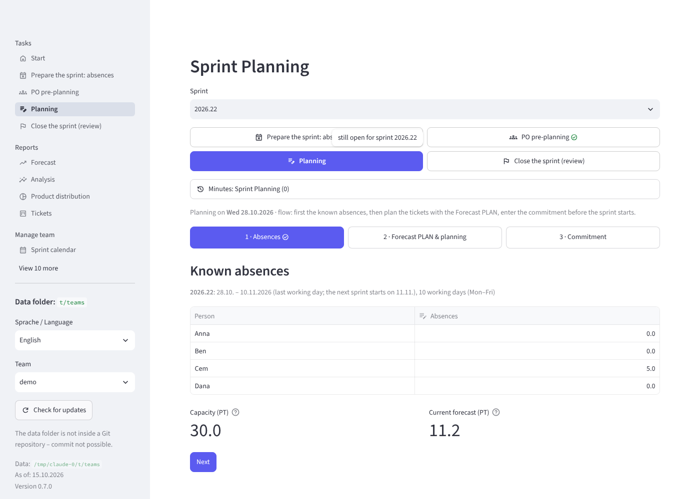
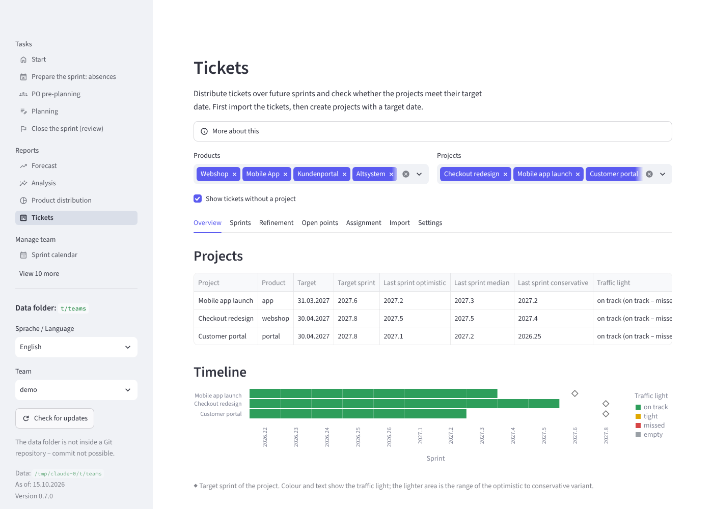
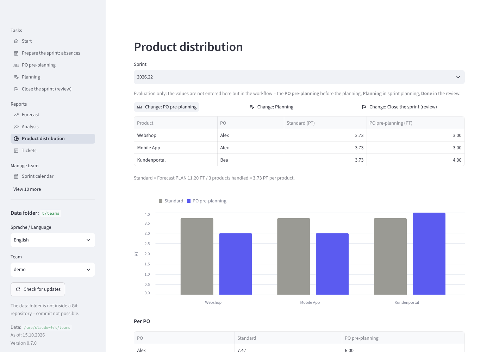
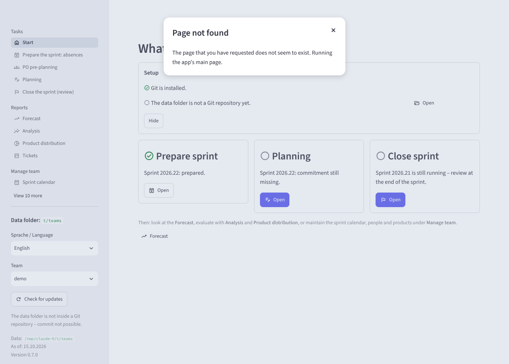

<p align="center">
  <picture>
    <source media="(prefers-color-scheme: dark)" srcset="docs/assets/logo-wordmark-dark.svg">
    
  </picture>
</p>

<h3 align="center">
  How much can the team plan in the next sprint? Velocity and capacity forecasts for Scrum teams,
  from plain YAML files in your own Git repository.
</h3>

<p align="center">
  <a href="https://github.com/swallat/foresprint/releases/latest"></a>
  <a href="https://github.com/swallat/foresprint/actions/workflows/ci.yml"></a>
  <a href="LICENSE"></a>
  
  
</p>

<p align="center">
  <picture>
    <source media="(prefers-color-scheme: dark)" srcset="docs/assets/screenshots/forecast-dark.png">
    
  </picture>
</p>

Foresprint turns your sprint history and your team's absences into a forecast: **how much can the
team plan in the next sprint?** It answers that mid-sprint too, so product owners can plan ahead
while the current sprint is still running. Every figure comes with the calculation behind it, with
the numbers substituted, so a forecast is something you can discuss, not just believe.

It is for Scrum teams that want to own their planning data. There is no server and no account: the
data is a folder of YAML files in a Git repository, and a local web UI and a command line read and
write the same files. Several people can work on them in parallel, and every change has an author
and a history. Foresprint does not tie you to a tracker or Git host; Jira and CSV exports are
supported for the ticket pre-planning, and Git hosting is just whatever your team already uses.

**Get started:** [install it](#installation) with one command, then [open the demo](#quick-start)
in a minute. The [documentation](#documentation) covers everything after that.

## Features

- **Forecast PLAN:** normalized velocity, moving average and trend, configurable per team, with a
  range from the conservative, median and optimistic variants. Every figure is traceable: the
  calculation view lists the formulas with the numbers substituted.
- **Capacity from a people list:** memberships with period and FTE, plannable absences per sprint,
  public holidays and working week per country and region (worldwide, through the `holidays`
  library). Absences are recorded in a grid and checked for plausibility.
- **Guided sprint workflow:** assistants for preparing the sprint (absences), PO pre-planning,
  planning and the review explain every field. Planning follows the meeting: absences, Forecast
  PLAN and planned amounts, then the commitment.
- **Several products:** default distribution, PO pre-planning, planning and done per product, with
  charts and balance; the product list can change over time.
- **Ticket pre-planning:** read tickets from Jira (read-only, with a personal access token) or a
  CSV export, assign them to projects with a small rule language, and distribute them over the
  coming sprints. A traffic light per project shows whether it meets its target date, the
  refinement list shows what is not ready, and the sums can be handed over as PO pre-planning.
- **Supplementary analyses:** range, focus factor, buffer, and "When will it be done?" (Monte
  Carlo).
- **Git without the terminal:** save and share, fetch others' changes, resolve conflicts per
  value, view the history and restore an earlier state, all from the web UI.
- **Excel round trip:** export a workbook with real formulas and import the yellow cells back.
- **Unit-neutral:** the estimation unit, story points (SP) or person days (PD), is a team setting.
- **English and German:** UI, command line and report in both languages, light and dark theme.
  The YAML files are always English (keys and comments).
- **Extensible and self-updating:** plugins add commands and pages; the app checks daily for a new
  version and installs it after exit (can be turned off).

## Screenshots

<table>
  <tr>
    <td width="50%">
      <picture>
        <source media="(prefers-color-scheme: dark)" srcset="docs/assets/screenshots/planning-dark.png">
        
      </picture>
      <br>Planning in three steps, as in the meeting
    </td>
    <td width="50%">
      <picture>
        <source media="(prefers-color-scheme: dark)" srcset="docs/assets/screenshots/tickets-dark.png">
        
      </picture>
      <br>Ticket pre-planning: does each project meet its target?
    </td>
  </tr>
  <tr>
    <td>
      <picture>
        <source media="(prefers-color-scheme: dark)" srcset="docs/assets/screenshots/products-dark.png">
        
      </picture>
      <br>Product distribution against the default
    </td>
    <td>
      <picture>
        <source media="(prefers-color-scheme: dark)" srcset="docs/assets/screenshots/analysis-dark.png">
        
      </picture>
      <br>Spread of the forecast and "When will it be done?"
    </td>
  </tr>
  <tr>
    <td colspan="2">
      <picture>
        <source media="(prefers-color-scheme: dark)" srcset="docs/assets/screenshots/start-dark.png">
        
      </picture>
      <br>The start page shows what is due next in the sprint
    </td>
  </tr>
</table>

<sub>The screenshots show the demo data in `examples/teams`.</sub>

## Installation

One command installs [uv](https://docs.astral.sh/uv/) if needed, downloads Python 3.14 and installs
Foresprint with the web UI. Git is needed for everything that commits, shares or clones data; the
app also finds Git outside the PATH (details in [Installation](docs/installation.md)).

**Windows (PowerShell):**

```powershell
powershell -ExecutionPolicy ByPass -c "irm https://raw.githubusercontent.com/swallat/foresprint/main/install.ps1 | iex"
```

**Linux / macOS:**

```bash
curl -LsSf https://raw.githubusercontent.com/swallat/foresprint/main/install.sh | sh
```

Then open a new terminal. The script also creates a desktop launcher (desktop and Start menu on
Windows, `~/Applications` on macOS, application entry on Linux) that opens the web UI as an app
window; the first start guides you through setting up the data folder. Running the script again
updates the installation; it asks about [plugins](docs/plugins.md#plugins-with-the-installer) and
remembers the answer. The script installs the extras `web`, `excel` (Excel export and import) and
`jira` (Jira import of the ticket pre-planning, read-only apart from the optional label write-back;
see [docs/jira.md](docs/jira.md)).

## Quick start

Try the demo first, in the folder of this repository:

```bash
sprintforecast --data examples/teams --as-of 2026-10-15 web        # the web UI with demo data
sprintforecast --data examples/teams --as-of 2026-10-15 forecast demo   # the forecast on the command line
```

Then use your own data. Teams are subfolders of the data directory:

```bash
cd sprint-data                     # data directory: one subfolder per team
sprintforecast init team-a         # create a team with guidance
sprintforecast web                 # web UI
sprintforecast help                # what to do when
```

On Windows PowerShell, `cd "$HOME\sprint-data"` and the same commands work. If the web UI finds no
data folder, it guides you through choosing, creating or cloning one. How the data directory is
found, every command and all settings are in [Command line and configuration](docs/cli.md); the
full sprint workflow is in [Sprint workflow](docs/sprint-workflow.md).

## How it fits together

- **Git is the database.** One sprint per YAML file, easy to diff and merge, so product owners and
  Scrum Masters can work in parallel. This repository contains only code and demo data; your team
  data lives in a separate repository, created from the template
  [`templates/daten-repo/`](templates/daten-repo) or from the web UI's *Data folder* page. See
  [Data repository](docs/data-repository.md).
- **Transparent calculation.** The formulas, capacity sources, trend modes and the uncertainty
  range are described in [Calculation](docs/calculation.md), and the app shows them with your
  numbers.
- **Read-only towards trackers.** The ticket pre-planning only reads from Jira; the one optional
  exception is a `planned_for_<sprint>` label. Nothing is changed in the tracker otherwise.

## Documentation

- [Installation and updates](docs/installation.md): Git lookup, desktop launcher, manual
  installation, automatic updates
- [Web UI](docs/web-ui.md): pages, planning steps, saving and sharing with Git, server setup, data
  folders, changes and history
- [Sprint workflow](docs/sprint-workflow.md): what to do when, PO pre-planning and planning, longer
  or shorter sprints
- [Command line and configuration](docs/cli.md): all commands, the data directory, language,
  environment variables, updating
- [Data format](docs/data-format.md): `team.yaml`, `people.yaml`, `products.yaml`, sprint files,
  `FORECAST.md`, minutes
- [Calculation](docs/calculation.md): formulas, capacity sources, trend modes, uncertainty,
  supplementary analyses
- [Jira import](docs/jira.md): ticket pre-planning from Jira Data Center with a personal access
  token (read-only; optional label write-back)
- [Plugins](docs/plugins.md): writing and installing plugins
- [Data repository](docs/data-repository.md): why Git, the template, separating code and data
- [Performance](docs/performance.md) and [Branding](docs/branding.md)
- `sprintforecast help [workflow|terms|fields|team|commands]` and the *Help* page of the web UI

## Contributing

Bug reports, questions and pull requests are welcome. [CONTRIBUTING.md](CONTRIBUTING.md) describes
the setup (Prerequisite: [mise](https://mise.jdx.dev)), tests, lint, the translation rule and the
CI. Releases are described in [docs/releasing.md](docs/releasing.md).

```bash
mise install
uv sync --all-extras
uv run sprintforecast --data examples/teams web   # run from source
uv run pytest
```

## License

[EUPL-1.2](LICENSE) (European Union Public Licence). In short: use is free, including commercial
and in-house use. Whoever distributes a modified version or offers it publicly as a service must
publish the changes under the EUPL.

All language versions approved by the European Commission are equivalent (Art. 13 EUPL). `LICENSE`
contains the English text; the official German version is in
[Commission Implementing Decision (EU) 2017/863](https://eur-lex.europa.eu/legal-content/DE/TXT/?uri=CELEX:32017D0863).
