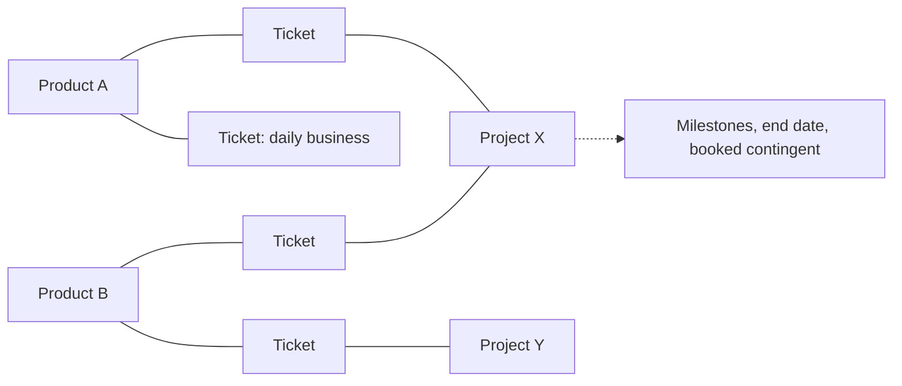
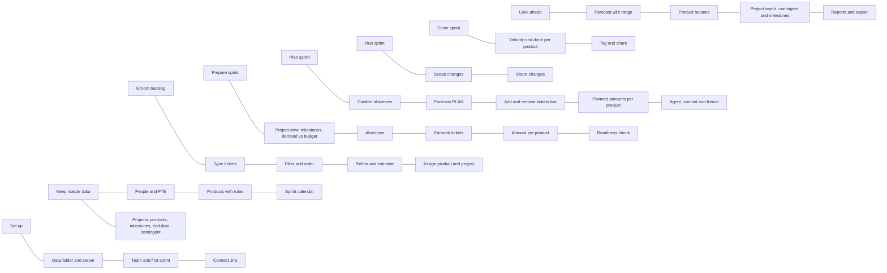
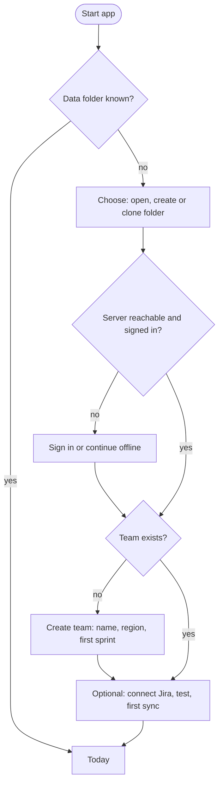
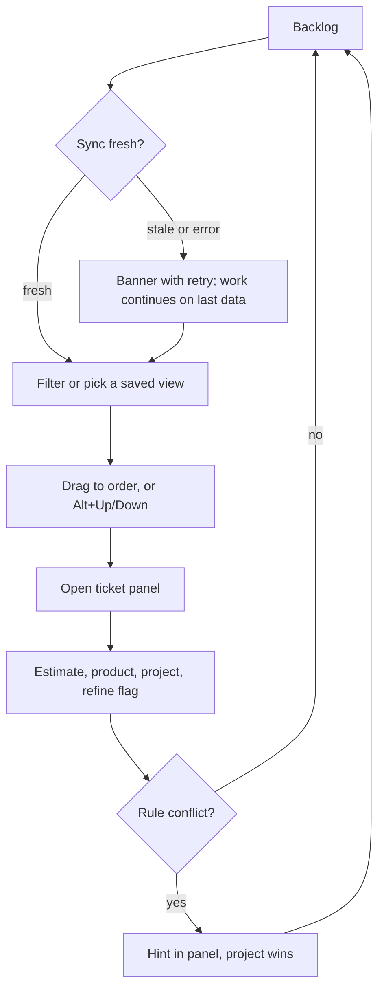
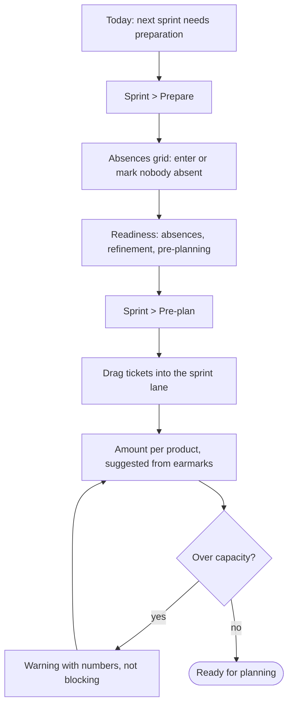
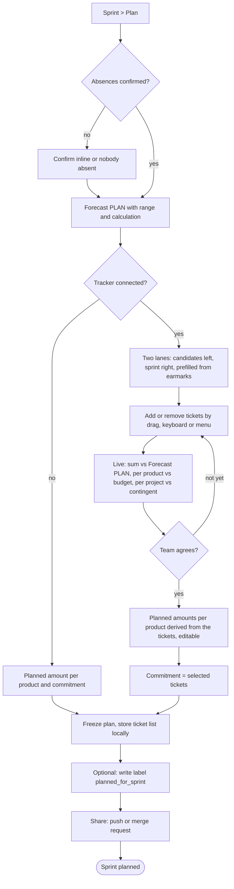
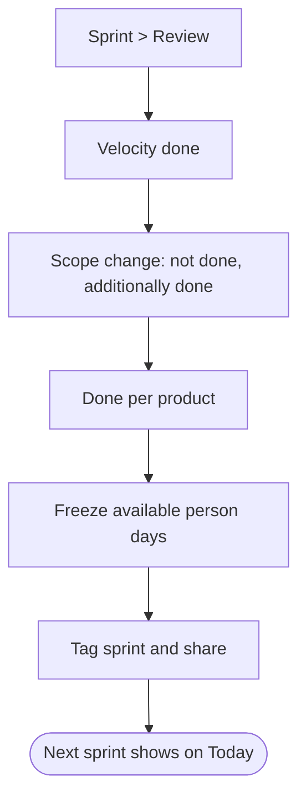
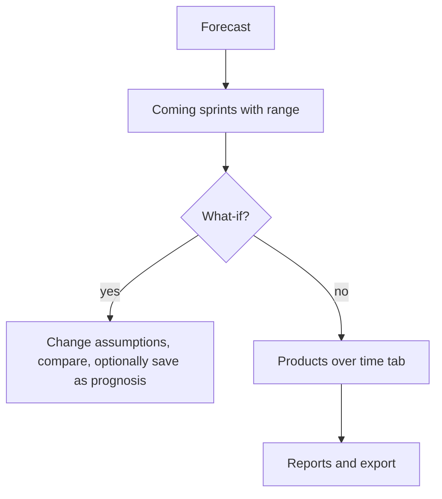
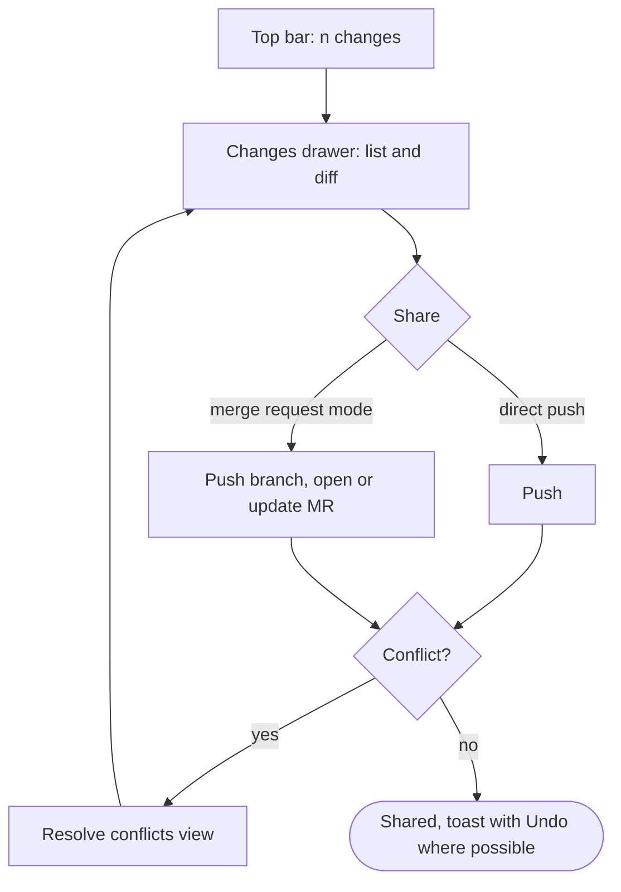
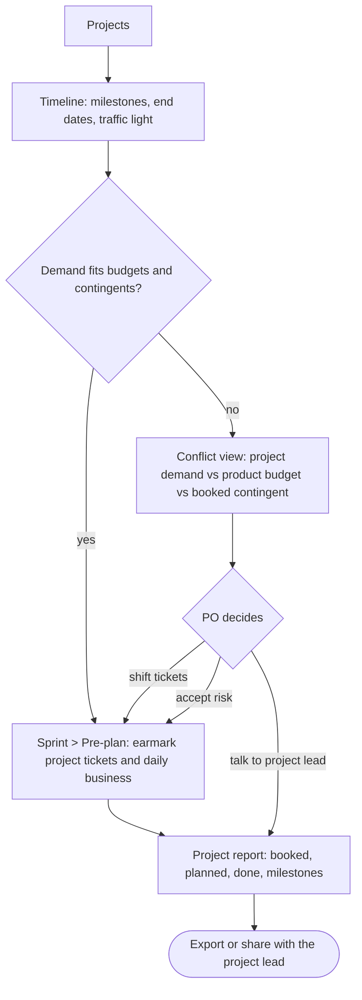

# Jobs, story map, flows and navigation for 1.0

Draft for review (Phase 1b). Input: [function-inventory.md](function-inventory.md) (F001 to F292, scattering D01 to D30).
Method: jobs to be done per role, story map after Patton (activities, steps, functions), one flow per activity, navigation derived last and checked by a tree test before any mock.

## 1. User

Foresprint is a desktop application with one kind of user: the person who plans for the team, a scrum master or a product owner (often both in one). There are no separate roles, permissions or views per role. Setup is done by the same user, rarely.

## 1a. Products, projects and daily business

Work is either **daily business** or a **project topic**. Products and projects are two independent axes:

- A **product** is a long-lived area with a PO and a budget share of the sprint.
- A **project** is a time-boxed undertaking with milestones and an end date. It can touch several products, and a product can take part in several projects; the sets do not overlap cleanly.
- A ticket always has a product. It has a project if it is project work; without a project it is daily business of its product.
- A project may have **booked contingents** (resources a project lead booked from the team, for example person days or points per sprint or period). Foresprint compares them with what is planned and done, so the PO can report back to the project lead.

Everything Foresprint derives here (assignment, budgets, traffic lights, contingent use) is a **recommendation**. The PO makes the final call; the numbers make demand visible.



Gap to 0.8: a project has at most one product (`Project.product`), only a target date (no milestones) and no contingents; "project wins" on a product conflict assumes one product per project. 1.0 needs: products per project as a list, milestones, contingents, and a new conflict rule (proposal: the product rule decides the ticket's product; a hint appears when it is not one of the project's products).

## 2. Jobs to be done

One user, scrum master or PO. Each job is one row of the function matrix (section 6). IDs J01 to J19.

| ID | When I ... | I want to ... | so that ... |
| --- | --- | --- | --- |
| J01 | start Foresprint for a new team | connect data folder, server and Jira in one guided setup | the team works on shared numbers from day one |
| J02 | learn about vacations or sick days | record them once per person and sprint | capacity and forecast are right everywhere |
| J03 | prepare the next sprint | see what is still missing (absences, pre-planning, refinement) | planning starts complete |
| J04 | look at my backlog | filter, order and refine tickets and assign them to products and projects | the next sprints carry the right work |
| J05 | prepare a sprint | earmark tickets and set the amount per product | planning is a confirmation, not a negotiation |
| J06 | run sprint planning | confirm absences, then add and remove tickets live against capacity and the Forecast PLAN until the team agrees, and freeze | the sprint has a plan everyone agreed to |
| J07 | close a sprint | record velocity, scope change and done per product | the forecast learns from what happened |
| J08 | am asked "when will it be done?" | see the forecast with range for the coming sprints | I can answer with confidence |
| J09 | want to check fairness across products | compare default, pre-planned, planned and done per product over time | budgets match agreements |
| J10 | the team or products change | edit people, FTE, products, projects and rules | the master data stays true |
| J11 | finished a change | share it with the team (push or merge request) and see what changed | nobody overwrites anybody |
| J12 | made a mistake | see the history of an object and undo or restore | errors are cheap |
| J13 | need numbers elsewhere | export a report or workbook, import Excel or CSV | Foresprint fits the existing tools |
| J14 | wonder what a number means | open its calculation and help in place | I trust the numbers |
| J15 | prepare the coming sprints | see work grouped by project with milestones and end dates next to daily business | I can tell what must come first |
| J16 | a project starts or changes | record its products, milestones, end date and booked contingent | the forecast knows what the project expects |
| J17 | a project lead asks how their project is doing | see booked vs planned vs done per sprint and the milestone traffic light, and export it | I can give a clear answer |
| J18 | project demand and product budgets disagree | see the conflict with numbers and decide | the decision stays mine, but is informed |
| J19 | look at any ticket anywhere | open it in the tracker with one click | I never search for a key by hand |

## 3. Story map

Backbone (left to right = the typical order in the sprint cadence). The order is not a navigation rule: every activity is reachable directly at any time (section 5), and only the steps inside one flow have an order. Setup runs once; the rest repeats every sprint, and grooming, master data and looking ahead happen whenever needed. Under each activity: the steps; the functions behind them are in section 6.



## 4. Consolidation rules

1. **One object, one home.** Every piece of data is edited in exactly one place; other places show it read-only with a link (Jira and Linear pattern).
2. **A sprint is a workspace, not four pages.** Absences, pre-planning, planning and review become the stages of one sprint view with one sprint selector (fixes D06, D07, D24).
3. **Stages are states, not pages.** "Pre-planned", "planned", "done" are columns of one product table per sprint (fixes D01, D21); "earmarked", "refined" are ticket states in the backlog (fixes D19).
4. **Views are filters.** Backlog, refinement list, open points and assignment are saved filters of one ticket list, details in a side panel.
5. **Git is global.** Change count, share and conflicts live in the top bar with one changes drawer; server, sign-in and history live in Settings (fixes D08 to D11, D13).
6. **Settings are separate from daily work.** Team, tracker, data and sharing, and personal settings each have one section (fixes D14 to D16).
7. **Every ticket links to its tracker.** Key and an open-in-tracker icon on every ticket row, card and panel (Jira today, GitHub or GitLab later).
8. **Every number explains itself.** Calculation and help open in place; no separate copies (fixes D05, D29).

## 5. Navigation proposal (text tree for the tree test)

```
Today                      state-aware: next step per sprint, sync state, findings
Backlog                    all tickets, group by project or product; saved views: Daily business, Refinement, Unassigned, Earmarked, Open points
  ticket panel             details, product, project, estimate, earmark, history
Sprints                    timeline of sprints with state chips
  <sprint>                 one workspace, one selector
    Prepare                absences grid (this sprint), readiness checklist
    Pre-plan               earmarked tickets by project and daily business, amount per product, contingent hints
    Plan                   ticket list vs sprint lane with live capacity and Forecast PLAN; planned amounts; agree and freeze
    Review                 velocity, scope change, done per product, tag
Projects                   portfolio: timeline with milestones and end dates, traffic light, contingent use
  <project>                products, milestones, contingent, tickets, report for the project lead
Forecast                   coming sprints with range; tabs: Analysis, Products over time, Reports and export
Team
  People and absences      people, FTE, absences grid across sprints
  Products                 products, assignment rules with live preview
  Sprint calendar          dates, length, sprint IDs
Settings
  Team                     forecast settings, features, budget basis
  Jira and tickets         connection, fields, sync interval, import
  Data and sharing         data folder, server, sign-in, merge request mode, history and restore, tags
  Personal                 theme, language, density, recent folders
Top bar                    team, sprint, sync state, changes (share, conflicts), search (Ctrl+K), help
```

## 6. Where the scattered functions go

| Scattering | Today | 1.0 home |
| --- | --- | --- |
| D01 Amount per product | PO pre-planning, Planning step 2, Tickets, Product distribution | Sprint > Pre-plan and Plan: one table with columns default, pre-planned, planned, done; ticket sums shown as suggestion |
| D02 Absences | Absences page, Planning step 1, announced absences on PO pre-planning | One absences grid (Team > People and absences, and filtered in Sprint > Prepare); announced vs confirmed is a cell state |
| D03 Capacity and PLAN preview | six views | One sprint summary bar at the top of the sprint workspace |
| D04 What-if | Forecast and PO pre-planning | Forecast, with "save as prognosis" as an explicit action |
| D06, D07 Sprint selection and entry | six selectors, eight routes | Sprints timeline and one selector in the top bar; Today links into the right stage |
| D08 to D11 Git | sidebar, Data folder, Changes and history | Top bar changes drawer (share, diff, conflicts); Settings > Data and sharing (server, identity, history, tags) |
| D12, D28 Data folder and setup | sidebar, Data folder, Start, first-start screen | First-run wizard; afterwards Settings > Data and sharing; recent folders in Personal |
| D13 Tokens | Data folder and Jira connection | Both under Settings with one sign-in pattern (still separate stores) |
| D14, D16 Team settings | Settings, New team, Jira connection, Excel import | Settings > Team; New team is a wizard over the same form; sprint IDs and lengths in Team > Sprint calendar |
| D15 Personal settings | sidebar, App settings | Settings > Personal |
| D17, D18, D30 Products, projects, rules | Products, Tickets > Assignment, Tickets > Settings, Jira connection | Products in Team > Products (rules, resulting default share); projects in the top-level Projects area (rules, products, milestones, contingent) |
| D19 Earmarking | buttons, drag, form | Drag in Backlog or Sprint > Pre-plan, plus menu and keyboard; note in the ticket panel |
| D20, D26 Import and export | Jira connection, Tickets > Import, Forecast, Settings | Settings > Jira and tickets (sources, import); Forecast > Reports and export (Excel, report); Excel import there too |
| D22 Production access | five places | Setting in Team; per sprint as a column of the product table |
| D23 Minutes | three save buttons, expanders | Sprint workspace activity log |
| D25 Histories | four separate | Per object "History" in the side panel; Git history in Settings |
| D27 Findings | Check page, save, share | Findings badge in the top bar, list on Today |

## 7. Flows

### F1 First start (J01)



### F2 Groom the backlog (J04)



### F3 Prepare and pre-plan a sprint (J02, J03, J05)



### F4 Plan a sprint (J06)

With a tracker connected, planning works on tickets; without one it stays amount-based (planned amount per product, commitment). The tracker stays read-only: the agreement is made and stored locally. After freezing, the optional label `planned_for_<sprint>` is the only write (existing exception).



Each ticket in both lanes shows key with tracker link, title, estimate, product, project and refinement state. Unrefined or unestimated tickets can be added but are flagged and counted separately.

### F5 Close a sprint (J07)



### F6 Answer "when will it be done?" (J08, J09)



### F7 Share changes (J11, J12)



### F8 Prepare with projects and report back (J15 to J18)



## 8. Tree test (before mocks)

Sebastian plus one or two other scrum masters or POs get the text tree of section 5 and answer "Where do you click to ...?" Target: 80 percent direct success.

1. ... record that Anna is on vacation in the next sprint?
2. ... move a ticket to the top of the backlog?
3. ... see how much product X gets in the next sprint?
4. ... freeze the plan of the current sprint?
5. ... find out when the epic Y will probably be done?
6. ... change the Jira query?
7. ... undo yesterday's change to a person's FTE?
8. ... share your changes with the team?
9. ... check whether project X still reaches its next milestone?
10. ... show a project lead how much of the booked contingent was used?
11. ... take a ticket out of the sprint during planning because the team disagrees?
12. ... open a ticket in Jira from the sprint plan?

## 9. Open questions

1. Announced vs confirmed absences as one grid with a cell state: needs a small data-format change or a UI-only mapping. Proposal: UI-only first.
2. Minutes: keep as files, or show only as an activity log?
3. Contingent unit and period: person days or points; per sprint, per month or in total for the project?
4. Where do contingents come from: entered by hand, or also read from a tracker field?
5. Milestones: dates only, or also a set of tickets per milestone (for its own traffic light)?
6. Product of a project ticket when the project spans several products: product rule decides (proposal), or the PO picks per ticket?
7. Planning with tickets: is the agreed ticket list the commitment, or does the commitment stay a number next to it?
8. Tickets that the tracker already lists in the sprint but the team takes out during planning: only a local note, or a hint to fix it in Jira?
