# Jobs, story map, flows and navigation for 1.0

Draft for review (Phase 1b). Input: [function-inventory.md](function-inventory.md) (F001 to F292, scattering D01 to D30).
Method: jobs to be done per role, story map after Patton (activities, steps, functions), one flow per activity, navigation derived last and checked by a tree test before any mock.

## 1. User

Foresprint is a desktop application with one kind of user: the person who plans for the team, a scrum master or a product owner (often both in one). There are no separate roles, permissions or views per role. The data still knows several POs: each product has a PO, and totals per PO stay. POs are not team members by default and do not count towards capacity; a PO who regularly takes on team work can be included with a share (FTE) and then counts like a person, absences included. Setup is done by the same user, rarely.

## 1a. Products, projects and daily business

Work is either **daily business** or a **project topic**. Products and projects are two independent axes:

- A **product** is a long-lived area with a PO and a budget share of the sprint.
- A **project** is a time-boxed undertaking with milestones and an end date. It can touch several products, and a product can take part in several projects; the sets do not overlap cleanly.
- A ticket always has a product. It has a project if it is project work; without a project it is daily business of its product.
- A project may have **booked contingents** (resources a project lead booked from the team, for example person days or points per sprint or period). Foresprint compares them with what is planned and done, so the PO can report back to the project lead.

Projects live in the data folder and work **without any tracker**: products, milestones, end date, contingent and notes are created and kept in Foresprint, offline. A tracker adds optional assignment rules that pull its tickets into a project; without one, tickets or plain work items are assigned by hand (0.8 already stores projects in `projects.yaml` and allows hand-kept tickets in `tickets.yaml`).

Everything Foresprint derives here (assignment, budgets, traffic lights, contingent use) is a **recommendation**. The PO makes the final call; the numbers make demand visible.

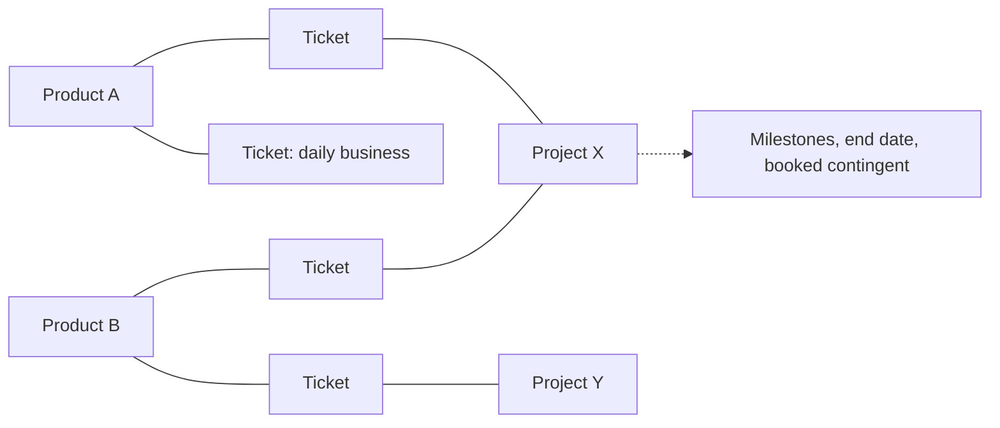

Gap to 0.8: a project has at most one product (`Project.product`), only a target date (no milestones) and no contingents; "project wins" on a product conflict assumes one product per project. 1.0 needs: products per project as a list, milestones, contingents, and a new conflict rule (proposal: the product rule decides the ticket's product; a hint appears when it is not one of the project's products).

## 2. Jobs to be done

One user, scrum master or PO. Each job is one row of the function matrix (section 6). IDs J01 to J26.

| ID | When I ... | I want to ... | so that ... |
| --- | --- | --- | --- |
| J01 | start Foresprint for a new team | connect data folder, server and Jira in one guided setup | the team works on shared numbers from day one |
| J02 | learn about vacations or sick days | record them once per person and sprint | capacity and forecast are right everywhere |
| J03 | prepare the next sprint | see what is still missing (absences, pre-planning, refinement) | planning starts complete |
| J04 | look at my backlog | filter, order and refine tickets and assign them to products and projects | the next sprints carry the right work |
| J05 | prepare a sprint | earmark tickets and set the amount per product | planning is a confirmation, not a negotiation |
| J06 | run sprint planning | confirm absences, then add and remove tickets live against capacity and the Forecast PLAN until the team agrees, and freeze | the sprint has a plan everyone agreed to |
| J07 | close a sprint | record velocity, scope change and done per product | the forecast learns from what happened |
| J08 | am asked "when will it be done?" | see the forecast with range for the coming sprints | I can answer with confidence |
| J09 | want to check fairness across products | compare default, pre-planned, planned and done per product over time | budgets match agreements |
| J10 | the team or products change | edit people, FTE, products, projects and rules | the master data stays true |
| J11 | finished a change | save it so the team sees it, without thinking about the storage | nobody overwrites anybody |
| J12 | made a mistake | see the history of an object and undo or restore | errors are cheap |
| J13 | need numbers elsewhere | export a report or workbook, import Excel or CSV | Foresprint fits the existing tools |
| J14 | wonder what a number means | open its calculation and help in place | I trust the numbers |
| J15 | prepare the coming sprints | see work grouped by project with milestones and end dates next to daily business | I can tell what must come first |
| J16 | a project starts or changes | record its products, milestones, end date and booked contingent, also without a tracker and offline | the forecast knows what the project expects |
| J17 | a project lead asks how their project is doing | see booked vs planned vs done per sprint and the milestone traffic light, and export it | I can give a clear answer |
| J18 | project demand and product budgets disagree | see the conflict with numbers and decide | the decision stays mine, but is informed |
| J19 | look at any ticket anywhere | open it in the tracker with one click | I never search for a key by hand |
| J20 | start working | see at a glance whether others changed something and take it over | I never plan on stale numbers |
| J21 | my team keeps its data in Git and the server enforces merge requests | still save with one click and get a link to the merge request | Foresprint works with our server rules |
| J22 | two people changed the same value | see both values side by side and pick per entry | nothing gets lost and I stay in control |
| J23 | have no connection to the server | keep working and save later | the network is never a blocker |
| J25 | discuss a ticket in planning or refinement while sharing one window | see description, acceptance criteria, subtasks, links, comments and attachments in Foresprint, large, and step through the list | the meeting never leaves Foresprint |
| J26 | the team plans completely in Foresprint | take the agreed sprint over into the tracker with one confirmed step | the tracker matches the plan without manual work |
| J24 | set up a team's storage | clone or open the team's Git repository (after 1.0 also choose a shared folder) | the team decides where its data lives |

## 3. Story map

Backbone (left to right = the typical order in the sprint cadence). The order is not a navigation rule: every activity is reachable directly at any time (section 5), and only the steps inside one flow have an order. Setup runs once; the rest repeats every sprint, and grooming, master data and looking ahead happen whenever needed. Under each activity: the steps; the functions behind them are in section 6.

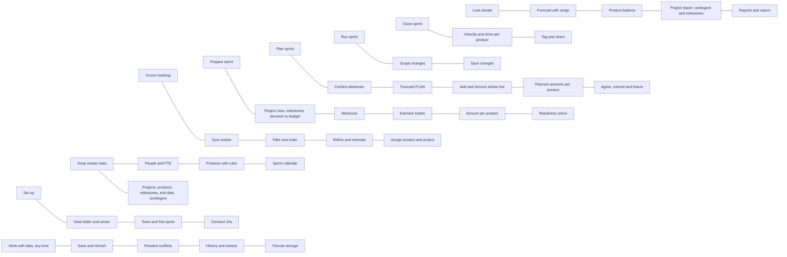

## 4. Consolidation rules

1. **One object, one home.** Every piece of data is edited in exactly one place; other places show it read-only with a link (Jira and Linear pattern).
2. **A sprint is a workspace, not four pages.** Absences, pre-planning, planning and review become the stages of one sprint view with one sprint selector (fixes D06, D07, D24).
3. **One table instead of one page per stage.** Today the amount per product is entered on PO pre-planning, again in Planning step 2 and shown on Product distribution (D01, D21). In 1.0 each sprint has one product table whose columns are the stages; each column is editable only in its stage:

    | PO | Product | Default | Pre-planned | Planned | of it prod | Done | of it prod |
    | --- | --- | --- | --- | --- | --- | --- | --- |
    | Kim | A | 12 | 10 | 11 | 3 | 9 | 2 |
    | Kim | B | 8 | 9 | 8 | 0 | 8 | 0 |
    | Kim | **Total** | 20 | 19 | 19 | 3 | 17 | 2 |
    | Lea | C | 6 | 6 | 5 | 1 | 5 | 1 |

    Rows are grouped by PO with a subtotal (D21). The production-access columns appear only when the feature is on and are shown, not enforced (D22). The same table over several sprints is the product balance in Forecast > Products over time.

    Likewise a ticket's "earmarked for sprint S" and "refined" are properties shown on the ticket wherever it appears (backlog row, sprint lane, panel), not separate lists or forms (D19).
4. **Views are filters.** Backlog, refinement list, open points and assignment are saved filters of one ticket list, details in a side panel.
5. **Storage: Git in 1.0, neutral UI.** In 1.0 the data lives in Git, for history and data integrity (decided 21.10.2026). A **shared folder** (file server, SharePoint) is supported after 1.0 through the same [storage interface](storage-interface.md). The UI therefore speaks one language: Save, Refresh, Changes from others, History, Resolve conflict. Git specifics (server, branch, token) sit in Settings > Storage. Save, Refresh and a status chip are in the top bar on every page; changes, conflicts and history have their own area **Data** (fixes D08 to D13, D28).
6. **Settings are separate from daily work.** Team, tracker, data and sharing, and personal settings each have one section (fixes D14 to D16).
7. **Every ticket links to its tracker.** Key and an open-in-tracker icon on every ticket row, card and panel (Jira today, GitHub or GitLab later).
8. **Always available: Forecast, Settings, PO pre-planning, saving and sync.** Save, Refresh, the status chip and the tracker sync sit permanently in the top bar and work from every page, also during an unfinished flow (an incomplete flow is saved as a draft). None of these depend on the sprint stage, on absences being confirmed, on a frozen plan or on a finished setup step. Missing inputs show as a hint in place, never as a locked page. Pre-planning works for any future sprint, also several sprints ahead.
9. **Stages are not gates.** Every stage of a sprint can be opened at any time; a stage that lacks input shows what is missing and still works with the data at hand.
10. **Pro-forma sprints.** A tracker sprint can be marked as pro forma in Settings > Jira and tickets (none, one or several), for example "Refinement" for tickets that go into the next refinement. Pro-forma sprints are shown as collapsible sections under the backlog, never count for capacity or forecast, and moving a ticket into or out of one is a local change listed under "adjust in Jira". Sprints without dates or with names like "Refinement" are suggested as pro forma.
11. **Trackers are optional.** Projects, products, sprints and planning work fully offline; a tracker only adds tickets and assignment rules on top.
12. **Every number explains itself.** Calculation and help open in place; no separate copies (fixes D05, D29). How much of this shows next to the numbers is a personal setting (Settings > Personal > Calculations): hidden, as a calculator icon (default) or always expanded below the number. Independent of that setting, Help > Calculations explains every formula once in full, with the team's own numbers filled in.
13. **Optional features appear only when configured.** A team with one product sees no product columns, product rules, budget or balance per product and no "Products over time"; with one PO no PO groups and sums; without production share no "of which prod". The same screens and flows stay, only the extra dimension disappears. Adding a second product, a second PO or switching on production share brings them back everywhere. Projects, contingents and the tracker are independent of this.

## 5. Navigation proposal (text tree for the tree test)

```
Today                      state-aware: next step per sprint, sync state, findings
Backlog                    all tickets with lanes for the coming sprints (PO pre-planning across sprints), pro-forma sprints (e.g. Refinement) as sections under the list, group by project or product; saved views: Daily business, Refinement, Unassigned, Earmarked, Open points
  ticket panel             Foresprint fields (product, project, estimate, earmark, note) plus tracker content read on sync: description, acceptance criteria, subtasks, links, comments, attachments; history
  presentation view        one ticket fills the window, arrows step through the current list, space adds or removes it on Sprint > Plan (for sharing one window in meetings)
Sprints                    timeline of sprints with state chips
  <sprint>                 one workspace, one selector
    Prepare                absences grid (this sprint), readiness checklist
    Pre-plan               earmarked tickets by project and daily business, amount per product, contingent hints
    Plan                   ticket list vs sprint lane with live capacity and Forecast PLAN; planned amounts; agree and freeze
    Review                 velocity, scope change, done per product, tag
    Minutes                written automatically on each save of pre-plan, plan and review (Markdown in protokolle/)
Projects                   portfolio: timeline with milestones and end dates, traffic light, contingent use
  <project>                products, milestones, contingent, tickets, report for the project lead; works offline, tracker rules optional
Forecast                   coming sprints with range, normalized velocity trend, plannable and small-items share; history as in 0.8 (capacity, commitment, velocity, normalized velocity, average, fulfillment, scope creep); chart with commitment, velocity, normalized velocity and Forecast PLAN; tabs: Analysis, Products over time, Reports and export
Team
  People and absences      people, FTE, POs (outside capacity unless included with a share), absences grid across sprints
  Products                 products, assignment rules with live preview (same rule language and editor as projects)
  Sprint calendar          dates, length, sprint IDs
Data                       the team's data, the same for every storage
  Overview                 where the data lives, status, who saved what recently, changes from others
  Conflicts                same value changed by two people: pick mine, theirs or edit; per entry
  History and tags         who changed what and when, restore a state, take back a change, tags (after 1.0 for folders: journal and daily snapshots)
Settings
  Team                     forecast settings, features, budget basis
  Jira and tickets         connection, fields (incl. acceptance criteria), sync interval, which tracker sprints are pro forma, write back (off by default: sprint assignment, label), import
  Storage                  Git: server, sign-in, branch, name and email, line endings, recent folders; after 1.0 also kind (Git or shared folder)
  Personal                 theme, language, density, calculations next to numbers (hidden, icon, expanded)
Help
  Calculations             every formula once: capacity, rate, Forecast PLAN and range, default per product, points in PD, traffic light, when done, balance; filled with the team's numbers
Always reachable, independent of sprint stage: Forecast, Settings, PO pre-planning (Backlog lanes and Sprint > Pre-plan), Save, Refresh and tracker sync (top bar).
Top bar                    team, sprint, Save, Refresh, status chip (Saved / 2 new changes from Anna / Conflict / Read only, no connection / Locked by Anna), tracker sync (last sync, sync now), search (Ctrl+K), help
```

## 6. Where the scattered functions go

| Scattering | Today | 1.0 home |
| --- | --- | --- |
| D01 Amount per product | PO pre-planning, Planning step 2, Tickets, Product distribution | Sprint > Pre-plan and Plan: one table with columns default, pre-planned, planned, done; ticket sums shown as suggestion |
| D02 Absences | Absences page, Planning step 1, announced absences on PO pre-planning | One absences grid (Team > People and absences, and filtered in Sprint > Prepare); announced vs confirmed is a cell state |
| D03 Capacity and PLAN preview | six views | One sprint summary bar at the top of the sprint workspace |
| D04 What-if | Forecast and PO pre-planning | Forecast, with "save as prognosis" as an explicit action |
| D06, D07 Sprint selection and entry | six selectors, eight routes | Sprints timeline and one selector in the top bar; Today links into the right stage |
| D08 to D11 Git | sidebar, Data folder, Changes and history | Save, Refresh and status chip in the top bar; Data > Overview, Conflicts, History; Git specifics only in Settings > Storage |
| D12, D28 Data folder and setup | sidebar, Data folder, Start, first-start screen | First-run wizard; afterwards Settings > Storage (recent folders there too) |
| D13 Tokens | Data folder and Jira connection | Git sign-in in Settings > Storage (only in Git mode), Jira token in Settings > Jira and tickets, same sign-in pattern |
| D14, D16 Team settings | Settings, New team, Jira connection, Excel import | Settings > Team; New team is a wizard over the same form; sprint IDs and lengths in Team > Sprint calendar |
| D15 Personal settings | sidebar, App settings | Settings > Personal |
| D17, D18, D30 Products, projects, rules | Products, Tickets > Assignment, Tickets > Settings, Jira connection | Products in Team > Products (rules, resulting default share); projects in the top-level Projects area (rules, products, milestones, contingent) |
| D19 Earmarking | buttons, drag, form | Drag in Backlog or Sprint > Pre-plan, plus menu and keyboard; note in the ticket panel |
| D20, D26 Import and export | Jira connection, Tickets > Import, Forecast, Settings | Settings > Jira and tickets (sources, import); Forecast > Reports and export (Excel, report); Excel import there too |
| D22 Production access | five places | Feature switch in Settings > Team, flag per person in Team > People, planned and done production part as columns of the product table; overload hint once in the sprint summary bar |
| D23 Minutes | written by three save buttons, shown only in an expander per board | Kept as today: every save of pre-plan, plan and review writes a Markdown file in `protokolle/` (same names, obsolete versions kept and marked), shared via Git with the other changes. Shown in a Minutes tab of the sprint workspace (all versions, open as file); planning minutes also list the agreed tickets with tracker links |
| D25 Histories | four separate | Per object "History" in the side panel; Git history in Settings |
| D27 Findings | Check page, save, share | Findings badge in the top bar, list on Today |

## 7. Flows

### F1 First start (J01)

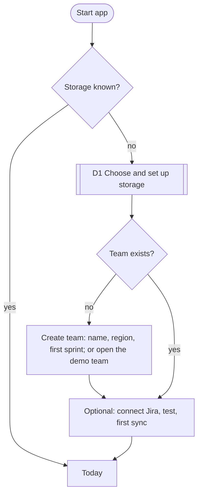

### F2 Groom the backlog (J04)

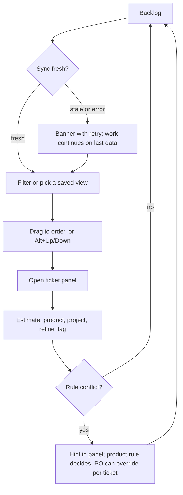

### F3 Prepare and pre-plan a sprint (J02, J03, J05)

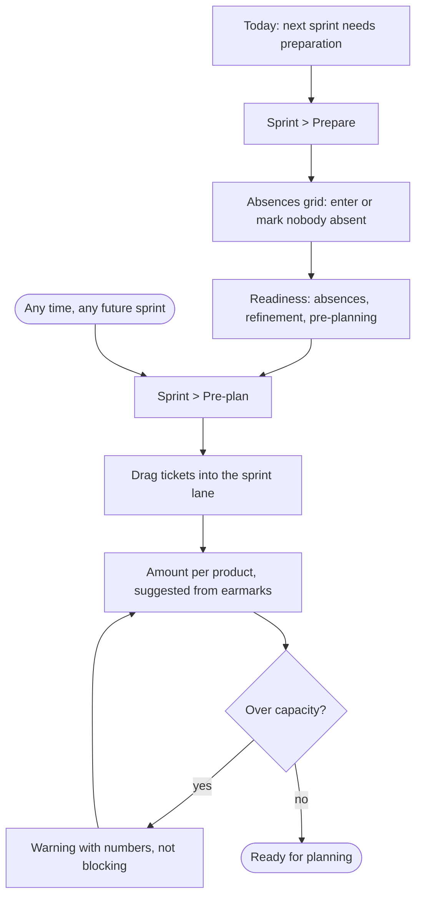

### F4 Plan a sprint (J06)

With a tracker connected, planning works on tickets; without one it stays amount-based (planned amount per product, commitment). By default the tracker stays read-only: the agreement is made and stored locally, and the optional label `planned_for_<sprint>` is written after freezing. If the team switched on "write sprint back" (Settings > Jira and tickets), "Reconcile with Jira" lists the tickets that enter or leave the tracker sprint, and "Take over into Jira" writes only the sprint field after a preview with per-ticket opt-out; undo right after, and the step goes into the planning minutes. "Presentation view" shows the candidates and sprint tickets with their tracker details in one window.

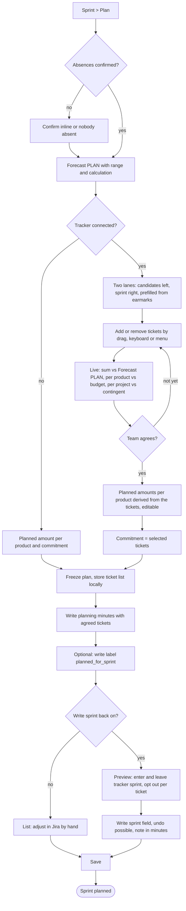

Each ticket in both lanes shows key with tracker link, title, estimate, product, project and refinement state. Unrefined or unestimated tickets can be added but are flagged and counted separately.

### F5 Close a sprint (J07)


### F6 Answer "when will it be done?" (J08, J09)

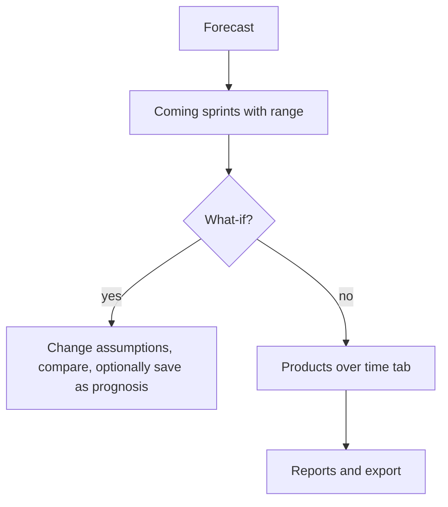

### Data flows (J11, J12, J20 to J24)

Scope 1.0: Git, all branches of these flows marked Git are in scope (including enforced merge requests, conflicts, history and tags). Branches marked folder come after 1.0 and are kept here so the storage interface fits them. The technical contract behind them is in [storage-interface.md](storage-interface.md).

Top bar, always visible: **Save**, **Refresh**, **status chip**. Save means "persist and make visible to the team": in Git it commits, pulls and pushes in one step (after 1.0, in a shared folder: write with a short lock).

#### D1 Choose and set up storage (J01, J24)

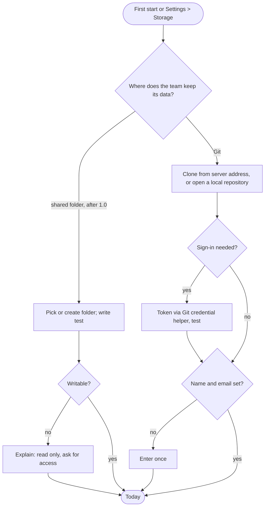

#### D2 Save and refresh (J11, J20)

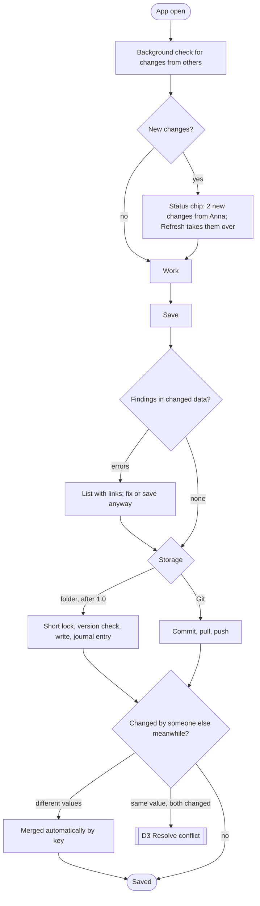

#### D3 Resolve a conflict (J22)

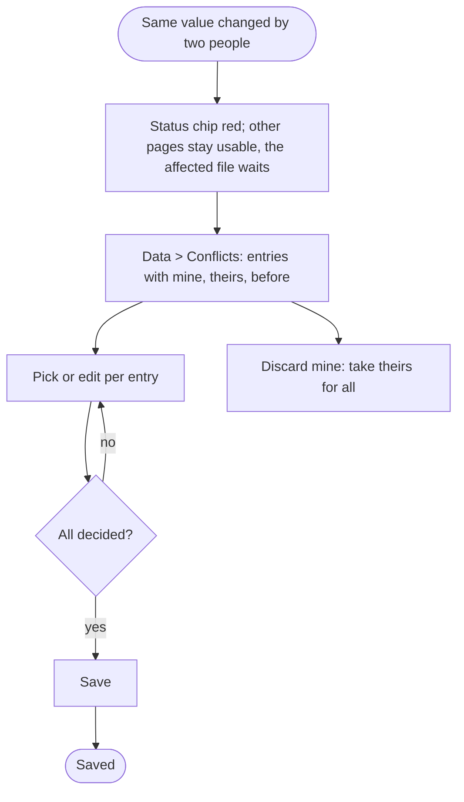

#### D4 Git server enforces merge requests (J21)

Foresprint has no merge request workflow of its own. It only handles servers that reject direct pushes to the main branch.

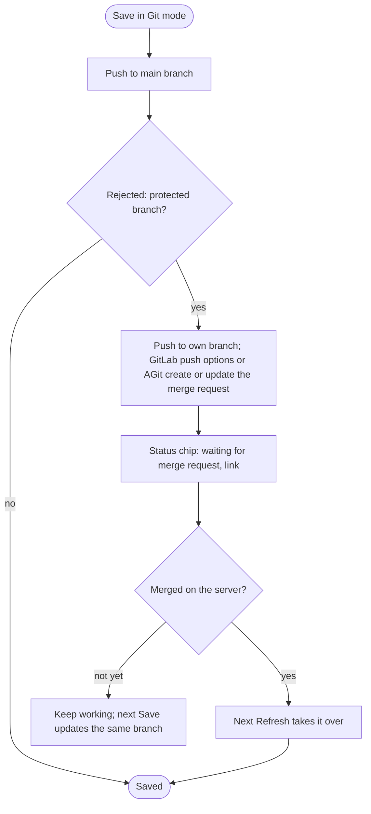

#### D5 No connection (J23)

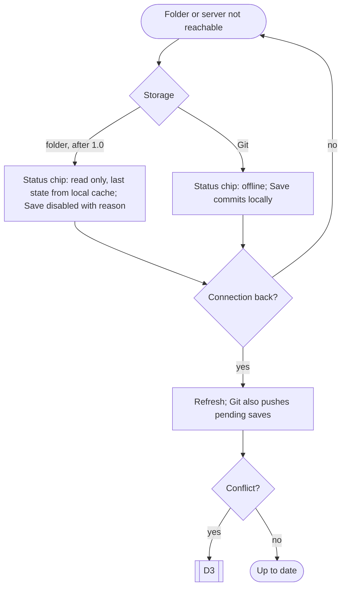

#### D6 History and restore (J12)

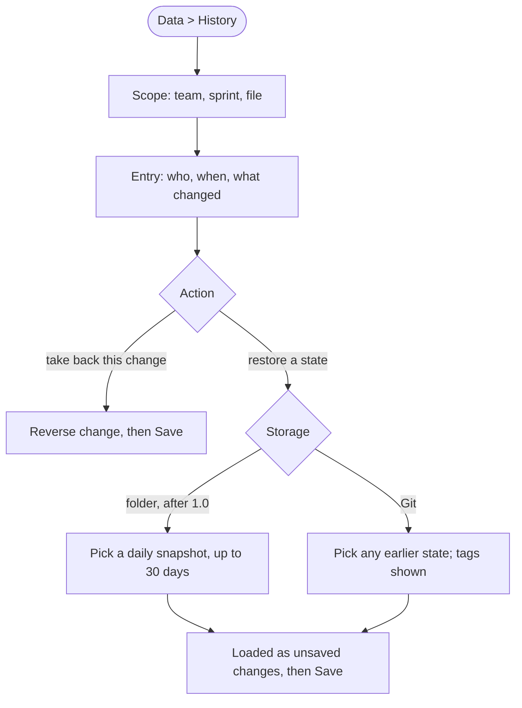

### F8 Prepare with projects and report back (J15 to J18)

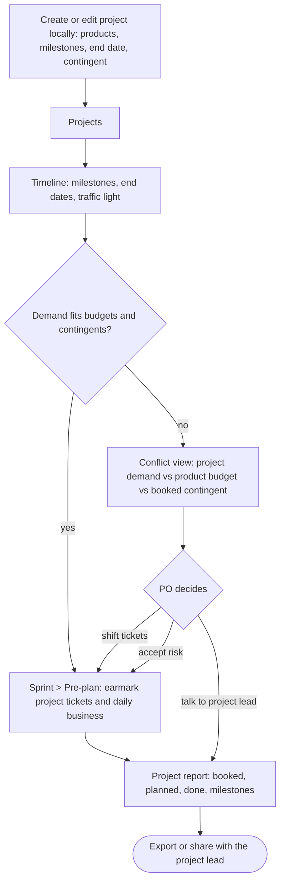

### F9 Understand a calculation

Job: "Why does the Forecast say 35 points?" Works from any number with a calculator icon.

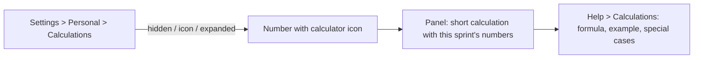

### F10 Show tickets in a meeting (J25)

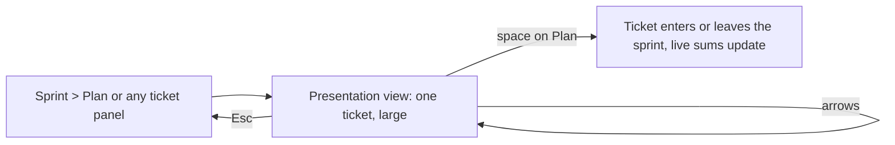

### F11 Take the agreed sprint over into the tracker (J26)

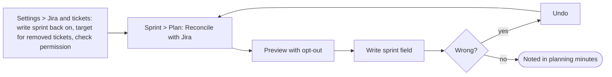

## 8. Tree test (before mocks)

The maintainer plus one or two other scrum masters or POs get the text tree of section 5 and answer "Where do you click to ...?" Target: 80 percent direct success.

1. ... record that Anna is on vacation in the next sprint?
2. ... move a ticket to the top of the backlog?
3. ... see how much product X gets in the next sprint?
4. ... freeze the plan of the current sprint?
5. ... find out when the epic Y will probably be done?
6. ... change the Jira query?
7. ... undo yesterday's change to a person's FTE?
8. ... share your changes with the team?
9. ... check whether project X still reaches its next milestone?
10. ... show a project lead how much of the booked contingent was used?
11. ... take a ticket out of the sprint during planning because the team disagrees?
12. ... open a ticket in Jira from the sprint plan?
13. ... resolve a conflict after saving?
14. ... set the Git server address or sign in again?
15. ... see what a colleague changed yesterday?

## 9. Decisions (maintainer, 21.10.2026)

1. **Absences:** announced and confirmed absences in one grid, each cell shows its state. UI only first, data format unchanged. Days are typed in directly (half days allowed). An open lock marks an announced entry, a closed lock a confirmed one. Per sprint, "Freeze" confirms the whole allocation: all entries count as confirmed, empty cells as 0 days, so "nobody absent" needs no extra button. A cleared value stays visible (struck through, with undo) until the next save.
2. **Contingents and units:** team planning stays in story points as today. Project contingents are booked in person days (PD) for the whole project, optionally split per month. Both live side by side: Foresprint converts points to PD with the team's own rate (points per available person day from the forecast data: normalized velocity). Planned uses the Forecast rate of that sprint, done uses the sprint's actual rate. Converted values are always marked as estimates.

    Example: rate 1.5 points per PD; project X has 12 points planned in sprint S -> about 8 PD of its 40 PD contingent.
3. **Contingent source:** entered by hand; a tracker field as source later and optional.
4. **Milestones:** a date, optionally with tickets assigned; with tickets it gets its own traffic light.
5. **Product of a project ticket** when the project spans several products: the product rule decides, the PO can override per ticket.
6. **Commitment with tickets:** the agreed ticket list is the commitment, its sum follows from it. A separate number remains only without a tracker.
7. **Ticket in the tracker's sprint but taken out in planning:** noted locally, shown in a list "adjust in Jira" and in the planning minutes. With write back switched on (decision 10) Foresprint moves it in the tracker to the backlog, a pro-forma sprint or the next sprint (team setting).
8. **Calculations:** explained in a help page (Help > Calculations) and switchable per person: hidden, icon or always expanded. The default UI stays light.
9. **Ticket details in Foresprint:** description, acceptance criteria, subtasks, links, comments and attachment names are read on each sync and cached locally per machine, not in the team data (YAML unchanged). A presentation view shows one ticket large for meetings.
10. **Write sprint back to the tracker (optional, 21.10.2026):** off by default, switched on per team. Only on an explicit button in Sprint > Plan, always with preview, per-ticket opt-out and undo, logged in the planning minutes. Only the sprint field (and the existing label) is written; order, estimate, status and texts stay untouched, and Foresprint never creates, starts or closes tracker sprints. The token needs the right to edit sprints; without it everything stays read-only. Writing the order back remains rejected.
11. **Product owners and capacity:** POs are outside the team and capacity by default; including one is an explicit choice with a share (FTE).
12. **One rule language for products and projects:** both use the expression rules from 0.8 (fields component, label, epic, priority, type, status plus configured extra fields; operators = != ~ !~ IN NOT IN, AND OR NOT, parentheses), with the same editor and live preview. Ligatures are off in rule text so `!=` stays visible as typed.
13. **Guided flows stay in the product (22.10.2026):** the step-by-step walkthroughs of the mocks (highlight, short text, next/back, runs on demo data) ship in 1.0 as an interactive tutorial under Help > Guided flows, one per flow F1 to F11. They run against the bundled demo team, never against the user's data, and can be started from the first-start screen. Texts live with the UI texts (German and English).
14. **What-if for the running sprint (22.10.2026, as in 0.8):** in Sprint > Pre-plan of the next sprint, the PO marks tickets of the running sprint as "will finish" or "carry-over" (without a tracker: commitment, expected not finished, additionally done). Expected velocity joins the rate history and changes the Forecast PLAN; carried-over points occupy the next sprint, Unfinished tickets count fully against the expected velocity (no partial credit), but only their remaining effort is carried: per ticket a "rest" value, prefilled from the tracker's remaining-estimate field if one is configured, otherwise the full estimate (without a tracker: one number "of which rest carried over"). "Free for new work" = Forecast PLAN minus remaining effort. Several assumptions (A, B, ...) can be kept side by side and compared; none is final. The definitive remaining effort is entered in the Review and replaces the assumption. A carry-over does not always continue in the next sprint: per ticket the PO chooses where it continues (next sprint as default, a later sprint, back to the backlog or a pro-forma sprint). Only rest that continues in the next sprint lowers what is plannable there; rest in a later sprint occupies that sprint, rest sent back to the backlog occupies nothing. Without tickets the PO enters only the rest that continues in the next sprint, and the Review asks for the same. Carry-over tickets can be earmarked with their rest in one click, each to its chosen target; an assumption can be saved as a prognosis. Forecast > What-if offers the same assumption as a single number.
15. **Where the work comes from (22.10.2026):** one team setting with three choices, applied on every page: (a) a tracker such as Jira (tickets are read; pulled-in tickets are detected by comparing the tracker sprint with the list frozen at Planning), (b) work packages kept in Foresprint (same flows, no fetch, no links, no rules), (c) no tickets (no Backlog; Pre-plan holds an amount per product and a split per project, the rest is daily business; Plan has amounts and a commitment number; projects keep contingents and traffic lights, their open scope is a number kept by hand; the running-sprint what-if uses numbers). The choice lives only in Settings > Tickets and tracker and in the first-start wizard, not as a switch on single pages. Without a tracker the Products page has no assignment rules (work packages carry their product, amounts need none), tracker connection, fetch, JQL, field mapping and write-back are hidden instead of greyed out, and work packages show keys like AP-424 without outside links. With work packages every text says "Arbeitspaket" instead of "Ticket". Work packages are created in the Backlog ("Arbeitspaket anlegen") or imported from CSV/Excel under Settings > Tickets and tracker; all details (title, status, type, priority, assignee, product, project, estimate, refined, labels, description, acceptance criteria, sub-tasks, dependencies, comments) are edited in the side panel and saved with the team data in arbeitspakete.yaml. A PO is removed from Team > People; their products must first go to another PO, and minutes and history keep the old name.
16. **People over time (22.10.2026, as in 0.8):** each person has membership periods (from, to, FTE). Leaving means entering the last day; until then the person counts, afterwards they are listed under "former" and stay in past sprints, minutes and velocity. Former people can rejoin with a new period. Deleting is only possible for people without history. Membership has three values: member (permanent), guest (helps out from another team) and external (temporary outside resource; needs an end date, a chip asks for it). All three count for capacity; minutes and calculations show guests and externals separately. Every date (entry, FTE periods, end) is editable in the times panel, also for former members; changes before today recalculate capacity and normalized velocity of past sprints, measured velocity stays.
17. **Free for new work:** the Pre-plan header shows Forecast PLAN (with the active assumption, if any) minus the remaining carry-over, in points and roughly in PD. It follows absences and assumptions immediately.
18. **Sprint naming pattern (22.10.2026):** the team sets a pattern in Team > Sprint calendar > "Sprint naming" with placeholders {JJJJ} year, {JJ} short year, {NN} number within the year (restarts each year, two digits), {N} same without padding, {LFD} running number over all sprints, {Q} quarter, {MM} month and {KW} ISO week of the sprint start. A new pattern applies from a chosen sprint on; past sprints keep their names unless "also rename past sprints" is chosen. A preview shows old and new names and flags duplicates. With a tracker the names are display names only; tracker sprints are still matched by sprint ID. Single sprints can still be renamed by hand.
19. **Estimation unit (22.10.2026):** Settings > Team > "Estimation unit and conversion" chooses story points or person days (PT) for team planning, valid from a chosen sprint. Conversion between the two uses the measured team rate (default, as in decision 2) or a fixed factor entered by the team. Past sprints keep their unit; Forecast and history convert with the factor that was valid then, and the calculation view shows it. Project contingents stay in PD.
20. **Plannable amount and production (22.10.2026):** the Pre-plan and Plan header shows "Verplanbar" (Forecast PLAN minus carried-over rest) in the team's estimation unit, with the other unit below (via the rate), and "Geplant" says how much is still free. With the production-access feature on, a tile "Produktion" compares the time of the people with production access in this sprint (their share of the person days, minus their absences) with the production part of the planned work, and a card in Pre-plan and Plan lists it. With tickets or work packages each item has a production share from 0 to 100 % of its estimate; 100 % means production only, so the "prod only" case needs no separate type. With a tracker the field is optional: the share comes, in this order, from a value set in Foresprint (kept in the team data), a mapped tracker field or a label meaning 100 %, the first matching production rule (same rule language as products and projects, e.g. `component = "Betrieb"` -> 100 %, set in Settings > Tickets und Tracker), otherwise 0 %. The Production card shows the source per ticket. Without tickets one PT value per sprint is entered. It warns, it never blocks. At Planning the production points per product are frozen into "davon Prod".
21. **Field mapping and rules in one place (22.10.2026):** Settings > Tickets und Tracker has one card "Feldzuordnung und Regeln". For each value Foresprint needs it says where it comes from: estimate, status and acceptance criteria always from a tracker field; product and project from rules (kept per product and project, linked from the card) or from a tracker field; refined from one rule or a field; production share from rules, a field with rules as fallback, or only by hand. Rules use one language for all trackers; extra tracker fields for rules are registered in the same card ("Felder für Regeln") and cannot be removed while a rule uses them. The JQL query above only limits which tickets are read; it assigns nothing. A value set by hand in Foresprint always wins.

## 10. Open questions

None at the moment.
