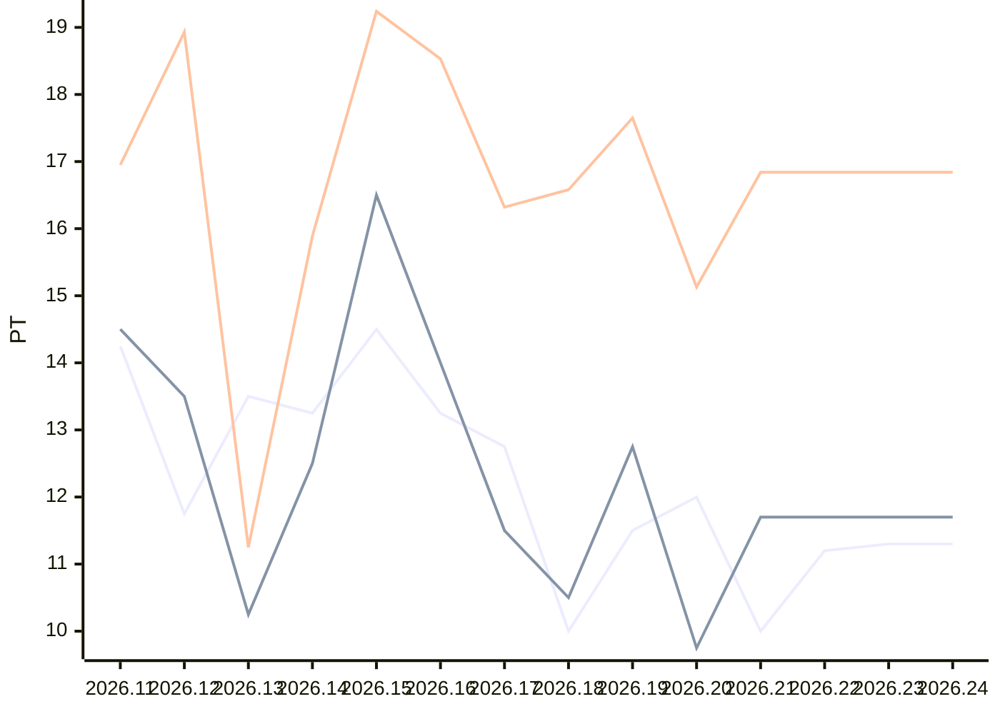

# Sprint-Forecast Demo-Team

Stand: 15.10.2026 · Einheit: PT · Referenzkapazität: 45 PT · Ø über 5 Sprints · Trend: `flat`

> Automatisch erzeugt mit `sprintforecast report`. Nicht von Hand bearbeiten.

## Prognose

| Sprint | Zeitraum | Status | Kapazität (PT) | n. Velocity-Trend | **Forecast PLAN** (PT) | Spanne | Verplanbar (80 %) | Kleinkram |
|---|---|---|---|---|---|---|---|---|
| 2026.21 | 14.10. – 28.10.2026 | **laufend** | 25,5 (Personenliste) | 16,84 | **9,5** | 8,5–10,5 | 7,60 | 1,90 |
| 2026.22 | 28.10. – 11.11.2026 | geplant | 30,0 (Personenliste) | 16,84 | **11,2** | 10,0–12,3 | 8,96 | 2,24 |
| 2026.23 | 11.11. – 25.11.2026 | geplant | 30,4 (erwartete Fehltage) | 16,84 | **11,3** | 10,2–12,5 | 9,04 | 2,26 |
| 2026.24 | 25.11. – 09.12.2026 | geplant | 30,4 (erwartete Fehltage) | 16,84 | **11,3** | 10,2–12,5 | 9,04 | 2,26 |

**Planning 2026.21:** Summe 8,50 PT, Delta zum Forecast PLAN 1,00 PT

## Verlauf (letzte 10 Sprints)

| Sprint | Kapazität (PT) | Commitment | Velocity | n. Velocity | Ø n. Velocity | Fulfillment | Scope Creep |
|---|---|---|---|---|---|---|---|
| 2026.11 | 38,5 | 14,25 | 14,50 | 16,95 | 14,98 | 102 % | 20 % |
| 2026.12 | 32,1 | 11,75 | 13,50 | 18,93 | 16,46 | 115 % | 10 % |
| 2026.13 | 41,0 | 13,50 | 10,25 | 11,25 | 15,61 | 76 % | 0 % |
| 2026.14 | 35,4 | 13,25 | 12,50 | 15,89 | 15,55 | 94 % | 5 % |
| 2026.15 | 38,6 | 14,50 | 16,50 | 19,24 | 16,45 | 114 % | 5 % |
| 2026.16 | 34,0 | 13,25 | 14,00 | 18,53 | 16,77 | 106 % | 20 % |
| 2026.17 | 31,7 | 12,75 | 11,50 | 16,32 | 16,25 | 90 % | 0 % |
| 2026.18 | 28,5 | 10,00 | 10,50 | 16,58 | 17,31 | 105 % | 5 % |
| 2026.19 | 32,5 | 11,50 | 12,75 | 17,65 | 17,66 | 111 % | 0 % |
| 2026.20 | 29,0 | 12,00 | 9,75 | 15,13 | 16,84 | 81 % | 5 % |

## Diagramm

Linien: Commitment (Vergangenheit) bzw. Forecast PLAN (Zukunft), Velocity und normierte Velocity (Vergangenheit: Ist-Wert, Zukunft: Trend).

## Produkte

**Sprint 2026.21** (laufend)

| Produkt | PO | Standard (PT) | PO-Vorplanung (PT) | Planning (PT) | Erledigt (PT) |
|---|---|---|---|---|---|
| Webshop | Alex | 3,17 | 3,50 | 4,00 | – |
| Mobile App | Alex | 3,17 | 3,00 | 3,00 | – |
| Kundenportal | Bea | 3,17 | 3,00 | 3,00 | – |

**Sprint 2026.22** (geplant)

| Produkt | PO | Standard (PT) | PO-Vorplanung (PT) | Planning (PT) | Erledigt (PT) |
|---|---|---|---|---|---|
| Webshop | Alex | 3,73 | 3,00 | – | – |
| Mobile App | Alex | 3,73 | 3,00 | – | – |
| Kundenportal | Bea | 3,73 | 4,00 | – | – |

**Saldo** (Σ Erledigt − Σ Standard, letzte 6 Sprints)

| Produkt | Sprints | Σ Standard | Σ Erledigt | Saldo (PT) |
|---|---|---|---|---|
| Webshop | 4 | 14,57 | 16,50 | 1,93 |
| Mobile App | 4 | 14,57 | 14,75 | 0,18 |
| Kundenportal | 3 | 10,33 | 8,75 | -1,58 |
| Altsystem | 2 | 6,73 | 4,50 | -2,23 |

## Ergänzend: Bandbreite

Forecast mit der niedrigsten, mittleren und höchsten normierten Velocity der letzten 5 Sprints (statt des Trends).

| Sprint | Forecast PLAN (PT) | konservativ | mittel | optimistisch |
|---|---|---|---|---|
| 2026.21 | 9,5 | 8,5 | 9,3 | 10,5 |
| 2026.22 | 11,2 | 10,0 | 11,0 | 12,3 |
| 2026.23 | 11,3 | 10,2 | 11,2 | 12,5 |
| 2026.24 | 11,3 | 10,2 | 11,2 | 12,5 |

- Ø Fokusfaktor (Velocity / Kapazität): 0,37
- Ø Scope Creep (5 Sprints): 6 % des Commitments = 6 % des Forecast PLAN · Kleinkram-Anteil: 20 %
