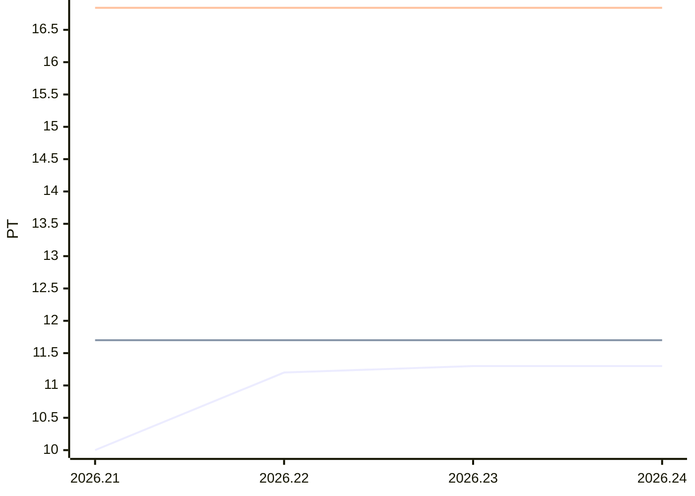

# Sprint-Forecast Demo-Team

As of: 15.10.2026 · unit: PT · reference capacity: 45 PT · Ø over 5 sprints · trend: `flat`

> Generated automatically with `foresprint report`. Do not edit by hand.

## Projection

| Sprint | Period | Status | Capacity (PT) | norm. velocity trend | **Forecast PLAN** (PT) | Range | Plannable (80 %) | Small items |
|---|---|---|---|---|---|---|---|---|
| 2026.21 | 14.10. – 28.10.2026 | **running** | 25.5 (people list) | 16.84 | **9.5** | 8.5–10.5 | 7.60 | 1.90 |
| 2026.22 | 28.10. – 11.11.2026 | planned | 30.0 (people list) | 16.84 | **11.2** | 10.0–12.3 | 8.96 | 2.24 |
| 2026.23 | 11.11. – 25.11.2026 | planned | 30.4 (expected absences) | 16.84 | **11.3** | 10.2–12.5 | 9.04 | 2.26 |
| 2026.24 | 25.11. – 09.12.2026 | planned | 30.4 (expected absences) | 16.84 | **11.3** | 10.2–12.5 | 9.04 | 2.26 |

**Planning 2026.21:** total 8.50 PT, delta to the Forecast PLAN 1.00 PT

## History (last 0 sprints)

| Sprint | Capacity (PT) | Commitment | Velocity | norm. velocity | Ø norm. velocity | Fulfillment | Scope creep |
|---|---|---|---|---|---|---|---|

## Chart

Lines: commitment (past) or Forecast PLAN (future), velocity and normalized velocity (past: actual value, future: trend).

## Products

**Sprint 2026.21** (running)

| Product | PO | Standard (PT) | PO pre-planning (PT) | Planning (PT) | Done (PT) |
|---|---|---|---|---|---|
| Webshop | Alex | 3.17 | 3.50 | 4.00 | – |
| Mobile App | Alex | 3.17 | 3.00 | 3.00 | – |
| Kundenportal | Bea | 3.17 | 3.00 | 3.00 | – |

**Sprint 2026.22** (planned)

| Product | PO | Standard (PT) | PO pre-planning (PT) | Planning (PT) | Done (PT) |
|---|---|---|---|---|---|
| Webshop | Alex | 3.73 | 3.00 | – | – |
| Mobile App | Alex | 3.73 | 3.00 | – | – |
| Kundenportal | Bea | 3.73 | 4.00 | – | – |

**Balance** (Σ done − Σ standard, last 6 sprints)

| Product | Sprints | Σ standard | Σ done | Balance (PT) |
|---|---|---|---|---|
| Webshop | 4 | 14.57 | 16.50 | 1.93 |
| Mobile App | 4 | 14.57 | 14.75 | 0.18 |
| Kundenportal | 3 | 10.33 | 8.75 | -1.58 |
| Altsystem | 2 | 6.73 | 4.50 | -2.23 |

## Additionally: range

Forecast with the lowest, median and highest normalized velocity of the last 5 sprints (instead of the trend).

| Sprint | Forecast PLAN (PT) | conservative | median | optimistic |
|---|---|---|---|---|
| 2026.21 | 9.5 | 8.5 | 9.3 | 10.5 |
| 2026.22 | 11.2 | 10.0 | 11.0 | 12.3 |
| 2026.23 | 11.3 | 10.2 | 11.2 | 12.5 |
| 2026.24 | 11.3 | 10.2 | 11.2 | 12.5 |

- Ø focus factor (velocity / capacity): 0.37
- Ø scope creep (5 sprints): 6 % of the commitment = 6 % of the Forecast PLAN · small-items share: 20 %
