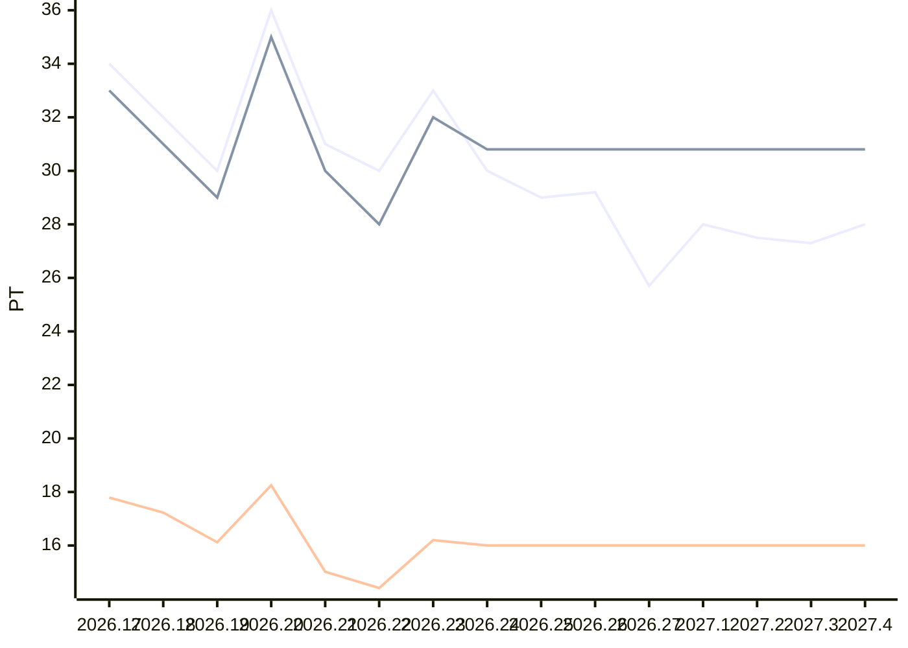

# Sprint-Forecast Golden people-days

As of: 05.01.2027 · unit: PT · reference capacity: 40 PT · Ø over 5 sprints · trend: `flat`

> Generated automatically with `foresprint report`. Do not edit by hand.

## Projection

| Sprint | Period | Status | Capacity (PT) | norm. velocity trend | **Forecast PLAN** (PT) | Range | Plannable (80 %) | Small items |
|---|---|---|---|---|---|---|---|---|
| 2026.27 | 30.12. – 13.01.2027 | **running** | 64.4 (announced absences) | 16.00 | **25.7** | 23.2–29.3 | 20.56 | 5.14 |
| 2027.1 | 13.01. – 27.01.2027 | planned | 70.2 (expected absences) | 16.00 | **28.0** | 25.2–32.0 | 22.40 | 5.60 |
| 2027.2 | 27.01. – 10.02.2027 | planned | 68.8 (expected absences) | 16.00 | **27.5** | 24.7–31.4 | 22.00 | 5.50 |
| 2027.3 | 10.02. – 24.02.2027 | planned | 68.4 (expected absences) | 16.00 | **27.3** | 24.6–31.2 | 21.84 | 5.46 |
| 2027.4 | 24.02. – 10.03.2027 | planned | 70.2 (expected absences) | 16.00 | **28.0** | 25.2–32.0 | 22.40 | 5.60 |

⚠️ Rate uncertain: 2 sprints in the expected absence rate (`2026.20`, `2026.25`) only count as confirmed because they have already been planned or reviewed; no absences are saved, so the rate assumes "0 % lost". The estimated capacity of future sprints may be too high.

## History (last 10 sprints)

| Sprint | Capacity (PT) | Commitment | Velocity | norm. velocity | Ø norm. velocity | Fulfillment | Scope creep |
|---|---|---|---|---|---|---|---|
| 2026.17 | 74.2 | 34.00 | 33.00 | 17.79 | – | 97 % | – |
| 2026.18 | 71.9 | 32.00 | 31.00 | 17.23 | 16.16 | 97 % | – |
| 2026.19 | 72.0 | 30.00 | 29.00 | 16.12 | 16.17 | 97 % | – |
| 2026.20 | 76.7 | 36.00 | 35.00 | 18.25 | 16.71 | 97 % | – |
| 2026.21 | 79.9 | 31.00 | 30.00 | 15.02 | 16.88 | 97 % | – |
| 2026.22 | 77.7 | 30.00 | 28.00 | 14.41 | 16.21 | 93 % | – |
| 2026.23 | 79.0 | 33.00 | 32.00 | 16.20 | 16.00 | 97 % | – |
| 2026.24 | 74.0 | 30.00 | – | – | – | – | – |
| 2026.25 | 81.7 | 29.00 | – | – | – | – | – |
| 2026.26 | 73.2 | – | – | – | – | – | – |

## Chart

Lines: commitment (past) or Forecast PLAN (future), velocity and normalized velocity (past: actual value, future: trend).

## Additionally: range

Forecast with the lowest, median and highest normalized velocity of the last 5 sprints (instead of the trend).

| Sprint | Forecast PLAN (PT) | conservative | median | optimistic |
|---|---|---|---|---|
| 2026.27 | 25.7 | 23.2 | 25.9 | 29.3 |
| 2027.1 | 28.0 | 25.2 | 28.2 | 32.0 |
| 2027.2 | 27.5 | 24.7 | 27.7 | 31.4 |
| 2027.3 | 27.3 | 24.6 | 27.5 | 31.2 |
| 2027.4 | 28.0 | 25.2 | 28.2 | 32.0 |

- Ø focus factor (velocity / capacity): 0.40
