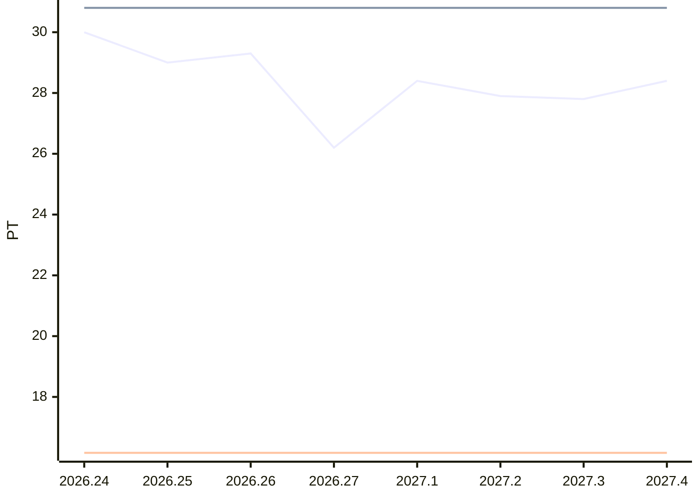

# Sprint-Forecast Golden people-share

As of: 05.01.2027 · unit: PT · reference capacity: 40 PT · Ø over 5 sprints · trend: `flat`

> Generated automatically with `foresprint report`. Do not edit by hand.

## Projection

| Sprint | Period | Status | Capacity (PT) | norm. velocity trend | **Forecast PLAN** (PT) | Range | Plannable (80 %) | Small items |
|---|---|---|---|---|---|---|---|---|
| 2026.27 | 30.12. – 13.01.2027 | **running** | 65 (announced absences) | 16.16 | **26.2** | 17.0–35.4 | 20.96 | 5.24 |
| 2027.1 | 13.01. – 27.01.2027 | planned | 70 ⚠️ Calendar, absences unknown | 16.16 | **28.4** | 17.3–39.5 | 22.72 | 5.68 |
| 2027.2 | 27.01. – 10.02.2027 | planned | 69 ⚠️ Calendar, absences unknown | 16.16 | **27.9** | 15.9–39.9 | 22.32 | 5.58 |
| 2027.3 | 10.02. – 24.02.2027 | planned | 69 ⚠️ Calendar, absences unknown | 16.16 | **27.8** | 14.9–40.7 | 22.24 | 5.56 |
| 2027.4 | 24.02. – 10.03.2027 | planned | 70 ⚠️ Calendar, absences unknown | 16.16 | **28.4** | 14.3–42.5 | 22.72 | 5.68 |

⚠️ *Trend/calendar*: no absences are recorded for this sprint yet, the capacity is estimated. `foresprint absences people-share <SPRINT>` makes the forecast reliable.

## History (last 3 sprints)

| Sprint | Capacity (PT) | Commitment | Velocity | norm. velocity | Ø norm. velocity | Fulfillment | Scope creep |
|---|---|---|---|---|---|---|---|
| 2026.24 | 73 | 30.00 | – | – | – | – | – |
| 2026.25 | 80 | 29.00 | – | – | – | – | – |
| 2026.26 | 73 | – | – | – | – | – | – |

## Chart

Lines: commitment (past) or Forecast PLAN (future), velocity and normalized velocity (past: actual value, future: trend).

## Additionally: range

Forecast with the lowest, median and highest normalized velocity of the last 5 sprints (instead of the trend).

| Sprint | Forecast PLAN (PT) | conservative | median | optimistic |
|---|---|---|---|---|
| 2026.27 | 26.2 | 23.7 | 26.2 | 29.9 |
| 2027.1 | 28.4 | 25.7 | 28.4 | 32.5 |
| 2027.2 | 27.9 | 25.2 | 27.9 | 31.9 |
| 2027.3 | 27.8 | 25.1 | 27.8 | 31.8 |
| 2027.4 | 28.4 | 25.7 | 28.4 | 32.5 |

- Ø focus factor (velocity / capacity): 0.40
