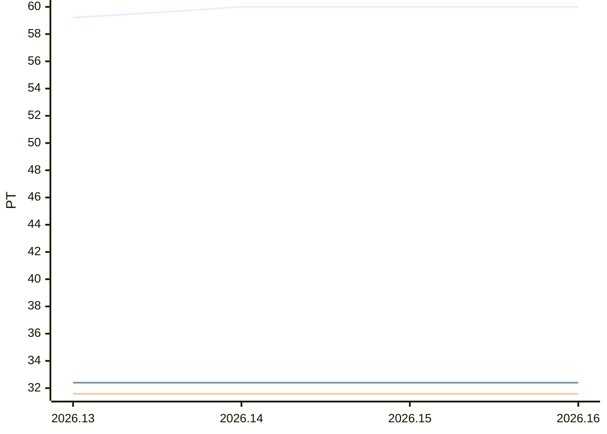

# Sprint-Forecast Golden products-edge

As of: 24.06.2026 · unit: PT · reference capacity: 40 PT · Ø over 5 sprints · trend: `flat`

> Generated automatically with `foresprint report`. Do not edit by hand.

## Projection

| Sprint | Period | Status | Capacity (PT) | norm. velocity trend | **Forecast PLAN** (PT) | Range | Plannable (75 %) | Small items |
|---|---|---|---|---|---|---|---|---|
| 2026.13 | 24.06. – 08.07.2026 | **running** | 75.0 ⚠️ Calendar, absences unknown | 31.58 | **59.2** | 55.2–64.2 | 44.40 | 14.80 |
| 2026.14 | 08.07. – 22.07.2026 | planned | 76.0 ⚠️ Calendar, absences unknown | 31.58 | **60.0** | 56.0–65.1 | 45.00 | 15.00 |
| 2026.15 | 22.07. – 05.08.2026 | planned | 76.0 ⚠️ Calendar, absences unknown | 31.58 | **60.0** | 56.0–65.1 | 45.00 | 15.00 |
| 2026.16 | 05.08. – 19.08.2026 | planned | 76.0 ⚠️ Calendar, absences unknown | 31.58 | **60.0** | 56.0–65.1 | 45.00 | 15.00 |

⚠️ *Trend/calendar*: no absences are recorded for this sprint yet, the capacity is estimated. `foresprint absences products-edge <SPRINT>` makes the forecast reliable.

## History (last 0 sprints)

| Sprint | Capacity (PT) | Commitment | Velocity | norm. velocity | Ø norm. velocity | Fulfillment | Scope creep |
|---|---|---|---|---|---|---|---|

## Chart

Lines: commitment (past) or Forecast PLAN (future), velocity and normalized velocity (past: actual value, future: trend).

## Products

**Sprint 2026.13** (running)

| Product | PO | Standard (PT) | PO pre-planning (PT) | Planning (PT) | Done (PT) |
|---|---|---|---|---|---|
| Web | Alex | 17.76 | – | – | – |
| App | Alex | 15.54 | – | – | – |
| API | Bea | 5.55 | – | – | – |
| New |  | 5.55 | – | – | – |

## Additionally: range

Forecast with the lowest, median and highest normalized velocity of the last 5 sprints (instead of the trend).

| Sprint | Forecast PLAN (PT) | conservative | median | optimistic |
|---|---|---|---|---|
| 2026.13 | 59.2 | 55.2 | 57.9 | 64.2 |
| 2026.14 | 60.0 | 56.0 | 58.7 | 65.1 |
| 2026.15 | 60.0 | 56.0 | 58.7 | 65.1 |
| 2026.16 | 60.0 | 56.0 | 58.7 | 65.1 |

- Ø focus factor (velocity / capacity): 0.79
