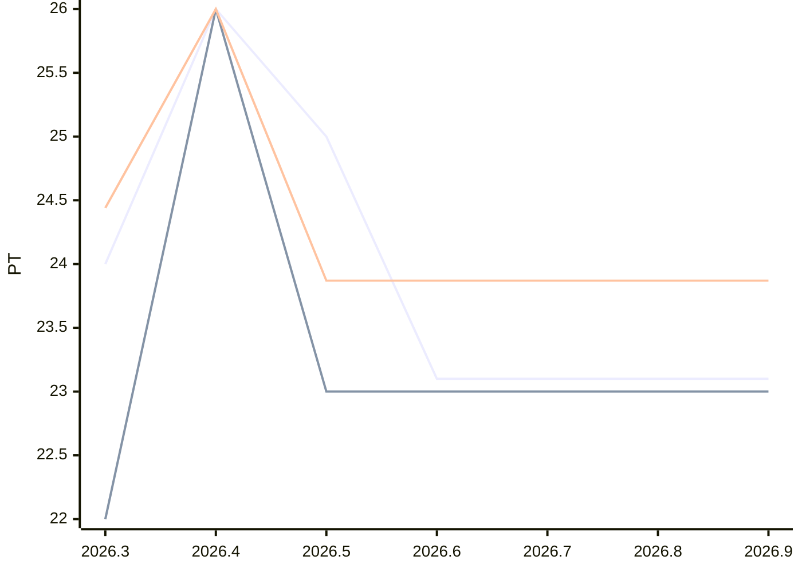

# Sprint-Forecast Golden thin

As of: 18.03.2026 · unit: PT · reference capacity: 40 PT · Ø over 6 sprints · trend: `linear`

> Generated automatically with `foresprint report`. Do not edit by hand.

## Projection

| Sprint | Period | Status | Capacity (PT) | norm. velocity trend | **Forecast PLAN** (PT) | Range | Plannable (80 %) | Small items |
|---|---|---|---|---|---|---|---|---|
| 2026.6 | 18.03. – 01.04.2026 | **running** | 38.8 ⚠️ Trend | 23.87 | **23.1** | 17.2–29.0 | 18.48 | 4.62 |
| 2026.7 | 01.04. – 15.04.2026 | planned | 38.8 ⚠️ Trend | 23.87 | **23.1** | 15.9–30.3 | 18.48 | 4.62 |
| 2026.8 | 15.04. – 29.04.2026 | planned | 38.8 ⚠️ Trend | 23.87 | **23.1** | 14.8–31.4 | 18.48 | 4.62 |
| 2026.9 | 29.04. – 13.05.2026 | planned | 38.8 ⚠️ Trend | 23.87 | **23.1** | 13.8–32.4 | 18.48 | 4.62 |

⚠️ *Trend/calendar*: no absences are recorded for this sprint yet, the capacity is estimated. `foresprint absences thin <SPRINT>` makes the forecast reliable.

⚠️ Little data: so far only 4 sprints with velocity (from 5 on, the range is more reliable). Plan and range are rough hints.

⚠️ Thin history: the history is not enough for trend mode linear, “constant” (last average) applies.

⚠️ Trend mode linear: extrapolates fluctuations and can rise or fall (caution with long horizons). “Constant” (flat) is robust – set with `foresprint settings`.

## History (last 3 sprints)

| Sprint | Capacity (PT) | Commitment | Velocity | norm. velocity | Ø norm. velocity | Fulfillment | Scope creep |
|---|---|---|---|---|---|---|---|
| 2026.3 | 36.0 | 24.00 | 22.00 | 24.44 | 23.17 | 92 % | – |
| 2026.4 | 40.0 | 26.00 | 26.00 | 26.00 | 23.87 | 100 % | – |
| 2026.5 | 40.0 | 25.00 | – | – | – | – | – |

## Chart

Lines: commitment (past) or Forecast PLAN (future), velocity and normalized velocity (past: actual value, future: trend).

## Additionally: range

Forecast with the lowest, median and highest normalized velocity of the last 4 sprints (instead of the trend).

| Sprint | Forecast PLAN (PT) | conservative | median | optimistic |
|---|---|---|---|---|
| 2026.6 | 23.1 | 20.4 | 23.4 | 25.2 |
| 2026.7 | 23.1 | 20.4 | 23.4 | 25.2 |
| 2026.8 | 23.1 | 20.4 | 23.4 | 25.2 |
| 2026.9 | 23.1 | 20.4 | 23.4 | 25.2 |

- Ø focus factor (velocity / capacity): 0.60
