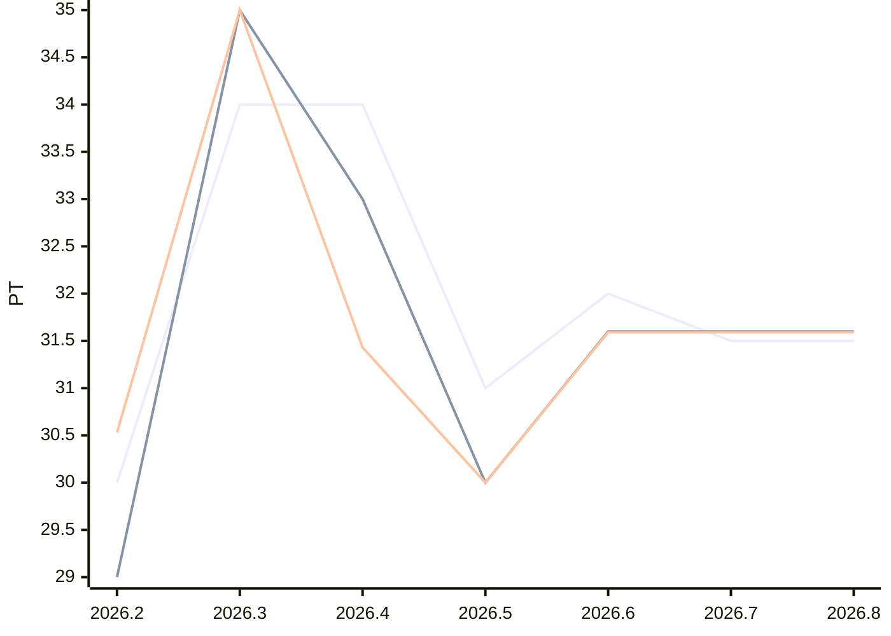

# Sprint-Forecast Golden tickets-products

As of: 08.07.2026 · unit: PT · reference capacity: 40 PT · Ø over 5 sprints · trend: `flat`

> Generated automatically with `foresprint report`. Do not edit by hand.

## Projection

| Sprint | Period | Status | Capacity (PT) | norm. velocity trend | **Forecast PLAN** (PT) | Range | Plannable (80 %) | Small items |
|---|---|---|---|---|---|---|---|---|
| 2026.5 | 01.07. – 15.07.2026 | **running** | 40.0 (recorded) | – | **31.0** | – | 24.80 | 6.20 |
| 2026.6 | 15.07. – 29.07.2026 | planned | 40.0 (recorded) | 31.59 | **31.5** | 27.6–35.4 | 25.20 | 6.30 |
| 2026.7 | 29.07. – 12.08.2026 | planned | 40.0 ⚠️ Trend | 31.59 | **31.5** | 26.0–37.0 | 25.20 | 6.30 |
| 2026.8 | 12.08. – 26.08.2026 | planned | 40.0 ⚠️ Trend | 31.59 | **31.5** | 24.7–38.3 | 25.20 | 6.30 |

⚠️ *Trend/calendar*: no absences are recorded for this sprint yet, the capacity is estimated. `foresprint absences tickets-products <SPRINT>` makes the forecast reliable.

## History (last 3 sprints)

| Sprint | Capacity (PT) | Commitment | Velocity | norm. velocity | Ø norm. velocity | Fulfillment | Scope creep |
|---|---|---|---|---|---|---|---|
| 2026.2 | 38.0 | 30.00 | 29.00 | 30.53 | – | 97 % | – |
| 2026.3 | 40.0 | 34.00 | 35.00 | 35.00 | – | 103 % | – |
| 2026.4 | 42.0 | 34.00 | 33.00 | 31.43 | – | 97 % | – |

## Chart

Lines: commitment (past) or Forecast PLAN (future), velocity and normalized velocity (past: actual value, future: trend).

## Products

**Sprint 2026.5** (running)

| Product | PO | Standard (PT) | PO pre-planning (PT) | Planning (PT) | Done (PT) |
|---|---|---|---|---|---|
| Web | Alex | 15.50 | – | – | – |
| App | Alex | 7.75 | – | – | – |
| Old | Bea | 7.75 | – | – | – |

**Sprint 2026.7** (planned)

| Product | PO | Standard (PT) | PO pre-planning (PT) | Planning (PT) | Done (PT) |
|---|---|---|---|---|---|
| Web | Alex | 15.75 | – | – | – |
| App | Alex | 5.25 | – | – | – |
| Old | Bea | 5.25 | – | – | – |
| New | Bea | 5.25 | – | – | – |

## Tickets

| Project | Target | Target sprint | Last sprint | Traffic light | Outstanding | Not distributable |
|---|---|---|---|---|---|---|
| Payment | 20.08.2026 | 2026.7 | 2026.9 | missed | 2 | 0 |
| Shop relaunch | 31.10.2026 | 2026.12 | 2026.10 | missed | 5 | 1 |
| Legacy | 01.12.2026 | 2026.15 | 2026.8 | on track | 6 | 0 |
| iOS | 15.12.2026 | 2026.16 | 2026.6 | missed | 3 | 2 |
| Migration | – | – | 2026.8 | on track | 2 | 0 |

| Sprint | Budget (PT) | Used | Free | Tickets |
|---|---|---|---|---|
| 2026.6 | 25.2 | 19.0 | 6.2 | 7 |
| 2026.7 | 25.2 | 15.0 | 10.2 | 4 |
| 2026.8 | 25.2 | 11.0 | 14.2 | 3 |
| 2026.9 | 25.2 | 3.0 | 22.2 | 1 |
| 2026.10 | 25.2 | 5.0 | 20.2 | 1 |
| 2026.11 | 25.2 | 0.0 | 25.2 | 0 |

0 tickets still have to be refined, 4 cannot be distributed.

## Additionally: range

Forecast with the lowest, median and highest normalized velocity of the last 5 sprints (instead of the trend).

| Sprint | Forecast PLAN (PT) | conservative | median | optimistic |
|---|---|---|---|---|
| 2026.5 | 31.0 | 30.0 | 31.0 | 35.0 |
| 2026.6 | 31.5 | 30.0 | 31.0 | 35.0 |
| 2026.7 | 31.5 | 30.0 | 31.0 | 35.0 |
| 2026.8 | 31.5 | 30.0 | 31.0 | 35.0 |

- Ø focus factor (velocity / capacity): 0.80
