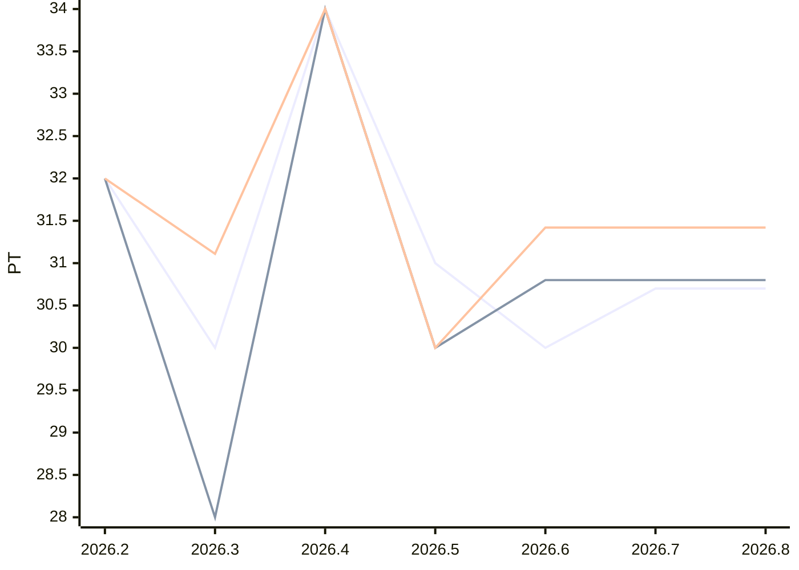

# Sprint-Forecast Golden tickets-simple

As of: 08.07.2026 · unit: PT · reference capacity: 40 PT · Ø over 5 sprints · trend: `flat`

> Generated automatically with `foresprint report`. Do not edit by hand.

## Projection

| Sprint | Period | Status | Capacity (PT) | norm. velocity trend | **Forecast PLAN** (PT) | Range | Plannable (80 %) | Small items |
|---|---|---|---|---|---|---|---|---|
| 2026.5 | 01.07. – 15.07.2026 | **running** | 40.0 (recorded) | – | **31.0** | 30.0–34.0 | 24.80 | 6.20 |
| 2026.6 | 15.07. – 29.07.2026 | planned | 40.0 (recorded) | 31.42 | **31.4** | 30.0–34.0 | 25.12 | 6.28 |
| 2026.7 | 29.07. – 12.08.2026 | planned | 39.2 ⚠️ Trend | 31.42 | **30.7** | 29.4–33.3 | 24.56 | 6.14 |
| 2026.8 | 12.08. – 26.08.2026 | planned | 39.2 ⚠️ Trend | 31.42 | **30.7** | 29.4–33.3 | 24.56 | 6.14 |

⚠️ *Trend/calendar*: no absences are recorded for this sprint yet, the capacity is estimated. `foresprint absences tickets-simple <SPRINT>` makes the forecast reliable.

## History (last 3 sprints)

| Sprint | Capacity (PT) | Commitment | Velocity | norm. velocity | Ø norm. velocity | Fulfillment | Scope creep |
|---|---|---|---|---|---|---|---|
| 2026.2 | 40.0 | 32.00 | 32.00 | 32.00 | – | 100 % | – |
| 2026.3 | 36.0 | 30.00 | 28.00 | 31.11 | – | 93 % | – |
| 2026.4 | 40.0 | 34.00 | 34.00 | 34.00 | – | 100 % | – |

## Chart

Lines: commitment (past) or Forecast PLAN (future), velocity and normalized velocity (past: actual value, future: trend).

## Tickets

| Project | Target | Target sprint | Last sprint | Traffic light | Outstanding | Not distributable |
|---|---|---|---|---|---|---|
| Beta | 01.08.2026 | 2026.6 | 2026.6 | missed | 4 | 1 |
| Alpha | 30.09.2026 | 2026.10 | 2026.10 | missed | 7 | 3 |
| Gamma | – | – | 2027.9 | on track | 62 | 0 |

| Sprint | Budget (PT) | Used | Free | Tickets |
|---|---|---|---|---|
| 2026.6 | 25.1 | 31.0 | -5.9 | 7 |
| 2026.7 | 24.5 | 24.0 | 0.5 | 3 |
| 2026.8 | 24.5 | 24.0 | 0.5 | 3 |
| 2026.9 | 24.5 | 29.0 | -4.5 | 4 |
| 2026.10 | 24.5 | 29.0 | -4.5 | 3 |
| 2026.11 | 24.5 | 24.0 | 0.5 | 3 |

3 tickets still have to be refined, 4 cannot be distributed.

## Additionally: range

Forecast with the lowest, median and highest normalized velocity of the last 5 sprints (instead of the trend).

| Sprint | Forecast PLAN (PT) | conservative | median | optimistic |
|---|---|---|---|---|
| 2026.5 | 31.0 | 30.0 | 31.1 | 34.0 |
| 2026.6 | 31.4 | 30.0 | 31.1 | 34.0 |
| 2026.7 | 30.7 | 29.4 | 30.4 | 33.3 |
| 2026.8 | 30.7 | 29.4 | 30.4 | 33.3 |

- Ø focus factor (velocity / capacity): 0.79
