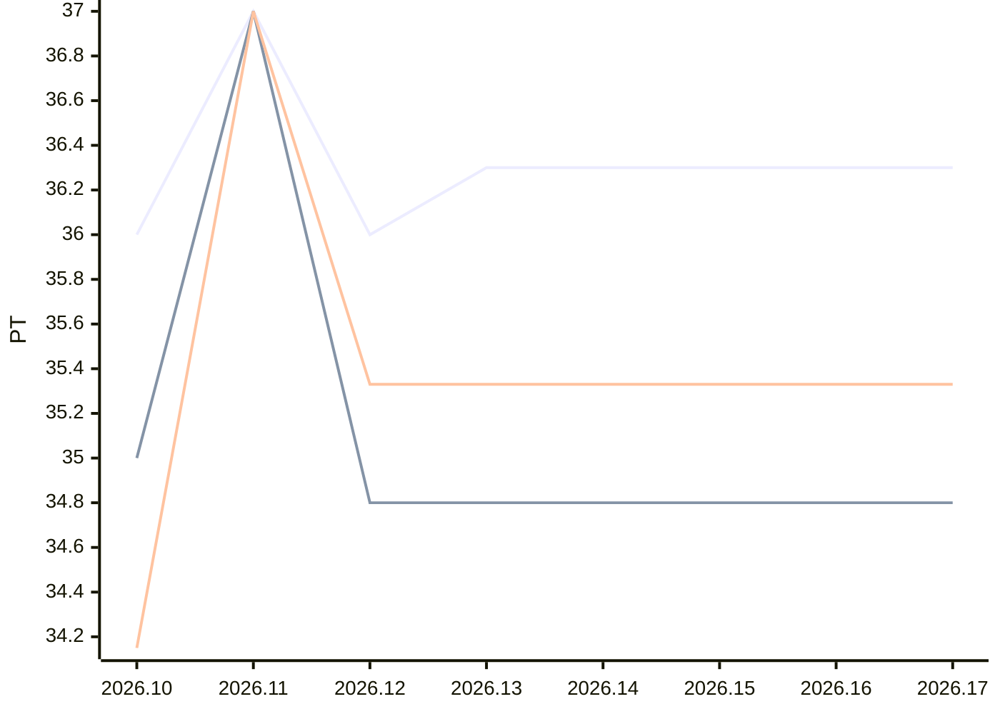

# Sprint-Forecast Golden trend-flat

As of: 24.06.2026 · unit: PT · reference capacity: 40 PT · Ø over 5 sprints · trend: `flat`

> Generated automatically with `foresprint report`. Do not edit by hand.

## Projection

| Sprint | Period | Status | Capacity (PT) | norm. velocity trend | **Forecast PLAN** (PT) | Range | Plannable (80 %) | Small items |
|---|---|---|---|---|---|---|---|---|
| 2026.13 | 24.06. – 08.07.2026 | **running** | 41.2 ⚠️ Trend | 35.33 | **36.3** | 35.9–38.9 | 29.04 | 7.26 |
| 2026.14 | 08.07. – 22.07.2026 | planned | 41.2 ⚠️ Trend | 35.33 | **36.3** | 35.9–38.9 | 29.04 | 7.26 |
| 2026.15 | 22.07. – 05.08.2026 | planned | 41.2 ⚠️ Trend | 35.33 | **36.3** | 35.9–38.9 | 29.04 | 7.26 |
| 2026.16 | 05.08. – 19.08.2026 | planned | 41.2 ⚠️ Trend | 35.33 | **36.3** | 35.9–38.9 | 29.04 | 7.26 |
| 2026.17 | 19.08. – 02.09.2026 | planned | 41.2 ⚠️ Trend | 35.33 | **36.3** | 35.9–38.9 | 29.04 | 7.26 |

⚠️ *Trend/calendar*: no absences are recorded for this sprint yet, the capacity is estimated. `foresprint absences trend-flat <SPRINT>` makes the forecast reliable.

## History (last 3 sprints)

| Sprint | Capacity (PT) | Commitment | Velocity | norm. velocity | Ø norm. velocity | Fulfillment | Scope creep |
|---|---|---|---|---|---|---|---|
| 2026.10 | 41.0 | 36.00 | 35.00 | 34.15 | 33.82 | 97 % | 0 % |
| 2026.11 | 40.0 | 37.00 | 37.00 | 37.00 | 35.33 | 100 % | 10 % |
| 2026.12 | 39.0 | 36.00 | – | – | – | – | – |

## Chart

Lines: commitment (past) or Forecast PLAN (future), velocity and normalized velocity (past: actual value, future: trend).

## Additionally: range

Forecast with the lowest, median and highest normalized velocity of the last 5 sprints (instead of the trend).

| Sprint | Forecast PLAN (PT) | conservative | median | optimistic |
|---|---|---|---|---|
| 2026.13 | 36.3 | 35.1 | 35.5 | 38.1 |
| 2026.14 | 36.3 | 35.1 | 35.5 | 38.1 |
| 2026.15 | 36.3 | 35.1 | 35.5 | 38.1 |
| 2026.16 | 36.3 | 35.1 | 35.5 | 38.1 |
| 2026.17 | 36.3 | 35.1 | 35.5 | 38.1 |

- Ø focus factor (velocity / capacity): 0.88
- Ø scope creep (5 sprints): 8 % of the commitment = 8 % of the Forecast PLAN · small-items share: 20 %
