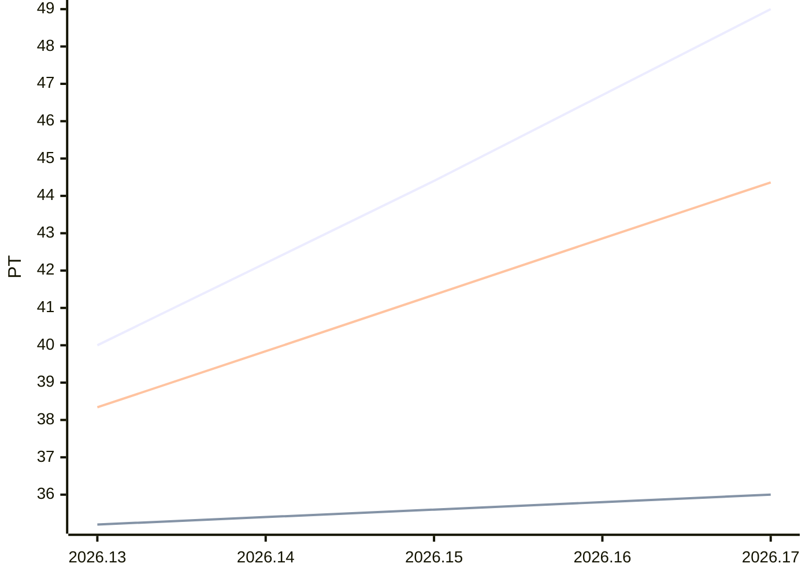

# Sprint-Forecast Golden trend-linear

As of: 24.06.2026 · unit: PT · reference capacity: 40 PT · Ø over 5 sprints · trend: `linear`

> Generated automatically with `foresprint report`. Do not edit by hand.

## Projection

| Sprint | Period | Status | Capacity (PT) | norm. velocity trend | **Forecast PLAN** (PT) | Range | Plannable (80 %) | Small items |
|---|---|---|---|---|---|---|---|---|
| 2026.13 | 24.06. – 08.07.2026 | **running** | 41.8 ⚠️ Trend | 38.34 | **40.0** | 35.8–44.2 | 32.00 | 8.00 |
| 2026.14 | 08.07. – 22.07.2026 | planned | 42.4 ⚠️ Trend | 39.84 | **42.2** | 37.0–47.4 | 33.76 | 8.44 |
| 2026.15 | 22.07. – 05.08.2026 | planned | 43.0 ⚠️ Trend | 41.35 | **44.4** | 38.3–50.5 | 35.52 | 8.88 |
| 2026.16 | 05.08. – 19.08.2026 | planned | 43.6 ⚠️ Trend | 42.86 | **46.7** | 39.8–53.6 | 37.36 | 9.34 |
| 2026.17 | 19.08. – 02.09.2026 | planned | 44.2 ⚠️ Trend | 44.36 | **49.0** | 41.3–56.7 | 39.20 | 9.80 |

⚠️ *Trend/calendar*: no absences are recorded for this sprint yet, the capacity is estimated. `foresprint absences trend-linear <SPRINT>` makes the forecast reliable.

⚠️ Trend mode linear: extrapolates fluctuations and can rise or fall (caution with long horizons). “Constant” (flat) is robust – set with `foresprint settings`.

## History (last 0 sprints)

| Sprint | Capacity (PT) | Commitment | Velocity | norm. velocity | Ø norm. velocity | Fulfillment | Scope creep |
|---|---|---|---|---|---|---|---|

## Chart

Lines: commitment (past) or Forecast PLAN (future), velocity and normalized velocity (past: actual value, future: trend).

## Additionally: range

Forecast with the lowest, median and highest normalized velocity of the last 5 sprints (instead of the trend).

| Sprint | Forecast PLAN (PT) | conservative | median | optimistic |
|---|---|---|---|---|
| 2026.13 | 40.0 | 35.6 | 36.1 | 38.6 |
| 2026.14 | 42.2 | 36.1 | 36.6 | 39.2 |
| 2026.15 | 44.4 | 36.7 | 37.1 | 39.7 |
| 2026.16 | 46.7 | 37.2 | 37.6 | 40.3 |
| 2026.17 | 49.0 | 37.7 | 38.1 | 40.8 |

- Ø focus factor (velocity / capacity): 0.88
- Ø scope creep (5 sprints): 8 % of the commitment = 8 % of the Forecast PLAN · small-items share: 20 %
